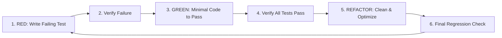

# StockLedger — AI Agent Operating Guidelines & Rules (`AGENTS.md`)

Welcome to the **StockLedger** project. This file establishes the operational rules, architectural boundaries, coding standards, and testing protocols for all AI agents and human contributors working on this codebase.

---

## 1. Project Philosophy & Core Purpose

StockLedger is a **focused, rock-solid inventory and order ledger** for small e-commerce merchants. Its mission is to eliminate overselling, maintain exact physical stock truth, and streamline packing and shipping without enterprise bloat.

### Non-Negotiable Boundaries
- **In Scope**: Order ingestion (manual, CSV, webhooks, platform sync), stock reservation, packing/shipping cost tracking, carrier tracking links, physical receiving, return grading/restocking, stock counting audits, low-stock warnings, and basic monthly shipping summary.
- **Strictly Out of Scope**: Real-time GPS tracking, printing shipping labels, payment processing, invoicing, or full-scale accounting software. Do not introduce dependencies or schema models for out-of-scope features.
- **No Coding Without Planning**: Always align on architecture and write tests before implementing production logic.

### The Governance Documents & Execution Flow
Every AI agent and contributor must maintain strict alignment across the project's governance documents:
1. [PROJECT-OVERVIEW.md](docs/pages/PROJECT-OVERVIEW.md) — The product scope, user stories, and strict non-negotiable boundaries.
2. [ARCHITECTURE.md](docs/pages/ARCHITECTURE.md) — The technical blueprint, data models, atomic SQL patterns, RFC 7807 error shapes, and package layout.
3. [AGENTS.md](AGENTS.md) — The operational rules: 3-law TDD mandate, testing pyramid, high-fidelity data rules, and quality gates.

---

## 2. Test-Driven Development (TDD) Mandate

**Strict Rule**: Every feature, bug fix, or behavioral change MUST follow the Test-Driven Development (TDD) cycle. Agents are strictly prohibited from writing production code before the corresponding test exists and fails.



### The 3 Laws of TDD for StockLedger
1. **No Production Code First**: You may not write any production Java code until you have written a failing unit or integration test.
2. **Minimal Test Code**: You may not write more of a test than is sufficient to fail; failure to compile counts as a failure.
3. **Minimal Production Code**: You may not write more production code than is necessary to make the failing test pass.

### Testing Strategy & Layers

| Test Layer | Tools | Scope & Purpose | Speed |
| :--- | :--- | :--- | :--- |
| **Unit Tests** | JUnit 5, AssertJ, Mockito | Pure domain calculations (e.g., available stock formula, shipping tier resolution, return grading). No Spring context. | < 50ms |
| **Repository / Native SQL Tests** | `@DataJpaTest`, Testcontainers PostgreSQL | Verifies atomic native SQL queries, constraints, optimistic locking, and Flyway migration schema. | ~500ms |
| **Web Slice Tests** | `@WebMvcTest`, MockMvc, Spring Security Test | Tests HTTP endpoints, request DTO validation, authorization rules (`OWNER` vs `STAFF`), and RFC 7807 error responses. | ~300ms |
| **Integration / E2E Tests** | `@SpringBootTest`, Testcontainers | End-to-end user journeys: Order ingestion -> Stock reservation -> Shipping -> Inventory ledger update. | ~1-2s |
| **Concurrency Tests** | ExecutorService, `CountDownLatch`, Testcontainers | Proves the zero-oversell invariant: concurrent order requests against a single remaining stock item must allow only one reservation. | ~1s |

---

## 3. Core Architectural Invariants

Every agent must preserve the following architectural guarantees:

### 1. The Inventory Ledger Equation
For any product variant:
$$\text{Available Stock} = \text{Physical On-Hand Stock} - \text{Reserved Stock} \ge 0$$
- `Physical On-Hand Stock`: Items physically on the shelves.
- `Reserved Stock`: Items committed to paid/confirmed orders awaiting packing or shipping.
- `Available Stock`: Sellable inventory. **Must never drop below zero.**

### 2. Atomic Inventory Mutations
- Inventory updates **MUST** use native SQL atomic predicates or database-level row locking:
  ```sql
  UPDATE inventory_levels
  SET reserved_quantity = reserved_quantity + :qty, updated_at = NOW()
  WHERE product_variant_id = :variantId
    AND (on_hand_quantity - reserved_quantity) >= :qty;
  ```
- **Never** perform in-memory calculate-and-save operations (`val = entity.getQty() - 1; entity.setQty(val); repo.save(entity)`) for inventory mutations, as this causes catastrophic lost updates under concurrency.

### 3. Double-Entry Audit Trail (`stock_movements`)
- Every change to inventory (reservation, shipment, receiving, return, manual count adjustment) MUST write an immutable record into `stock_movements`.
- The ledger is append-only. Past stock movements must never be updated or deleted.
- `order_items.sku` and `stock_movements.sku`/`product_name` are **historical snapshots** written when the row is created. Editing the catalogue must never rewrite past order lines or movements, and responses must read the snapshot rather than the current variant. Pass the snapshot values explicitly into `StockMovement.create(...)` before any native inventory update clears the persistence context.
- Creating a product MUST create a zero-stock `inventory_levels` row for every new variant. Receiving stock expects that row to exist and fails confusingly without it.
- **Retirement replaces deletion.** A product or variant is retired, never deleted, so past orders and movements survive. `products.active` and `product_variants.active` are independent; a variant is sellable only when both are active, and retiring a product must not rewrite its variants. Every retire or restore appends one `RETIRED`/`RESTORED` row to the append-only `product_catalog_events` table with name, SKU, actor, and time snapshots; a request that changes nothing appends nothing. Order intake and supplier receiving MUST refuse a retired item with `409 PRODUCT_RETIRED`; returns and restocks remain allowed.

### 4. Role-Based Access Control (RBAC)
- All endpoints must enforce role restrictions according to `PROJECT-OVERVIEW.md`:
  - `ROLE_OWNER`: Full access (settings, price lists, platform sync tokens, user management, export data, shipping summaries).
  - `ROLE_STAFF`: Operational access only (orders, packing, shipping, stock receiving, stock counts, viewing history). Forbidden from exports, financial summaries, settings, user admin, and product creation or editing.
- Controllers or service methods must use `@PreAuthorize("hasRole('OWNER')")` or `@PreAuthorize("hasAnyRole('OWNER', 'STAFF')")`. Product `POST` and `PUT` routes, and the retire/restore routes, are `ROLE_OWNER` only; product reads are available to both roles with cost withheld from staff.

### 5. High-Fidelity Domain Data Mandate
- **No Placeholder Garbage**: Agents are strictly prohibited from using lazy dummy strings (e.g. `"Product 1"`, `"foo"`, `"bar"`, `"test@test.com"`, `"123 Street"`).
- **Realistic Retail Attributes**: All test fixtures, seed data, and mocks MUST use realistic e-commerce attributes:
  - Authentic product names with parent-variant hierarchies (e.g. `Heavyweight Cotton Hoodie`, `Size: XL`, `Color: Navy`).
  - Realistic, structured SKUs (e.g. `HOOD-NVY-XL`, `COF-ETH-250G`) and valid EAN-13 barcodes (e.g. `5060123456789`).
  - Realistic margins and weights (wholesale cost vs retail price, weight in grams).
  - Authentic domestic and international shipping addresses with realistic postal codes.
  - Realistic carrier formats (e.g. 10-digit DHL Express AWB `1234567890`).

### 6. Order Ingestion Safety (The 4 Channels)
- **Manual Entry**: Must execute synchronous Jakarta validation; reject negative quantities and invalid SKUs with RFC 7807 `400 Bad Request`.
- **CSV Import**: Must parse streaming rows and return a structured partial-success report detailing rejected row numbers and error descriptions rather than crashing the batch.
- **Inbound Webhooks**: Must enforce cryptographic HMAC-SHA256 signature verification in `WebhookSignatureFilter` and deduplicate requests via `idempotency_records`.
- **Platform Sync**: Must be tested using **WireMock** to simulate external platform REST responses (success, rate limits, timeouts) with zero live cloud dependency.

### 7. Security Audit Trail (`auth_events`)
- Security-sensitive actions (authentication, logout, password changes/resets, user creation/deactivation/reactivation/role changes) **must** append to `auth_events`. The table is append-only and enforced by a database trigger; never update or delete historical rows.
- Actor and subject identifiers/emails are snapshotted, with no foreign keys to `users`, so the audit trail survives account deactivation or deletion. Test cleanup uses `TRUNCATE` via `AuthEventTestSupport`.
- Audit writes in authentication attempts must not take down sign-in: log and count the failure. Audit writes in state-changing flows are part of the transaction and fail closed.
- Never log passwords, raw credentials, or session identifiers. Use the `SECURITY_AUDIT` logger and the request id from `RequestIdFilter`.
- The audit trail is retained for 24 months. Purging is a manual break-glass runbook under a change record, not an application job.

### 8. Platform Connection History (`platform_connection_events`)
- Every change to a platform connection **must** append exactly one history row: the connection, the platform type at the time, the kind of save (`CREATED`, `UPDATED`, `PAUSED`, `RESUMED`), the actor, the time, the affected **field names**, and — for a pause — the reason.
- Never store values, tokens, or signing secrets in the history. A save that changes nothing appends nothing.
- The table is append-only and enforced by a database trigger; test cleanup uses `TRUNCATE` via `PlatformConnectionEventTestSupport`. History writes are part of the caller's transaction and fail closed.
- History is retained for 24 months under the same break-glass purge policy as `auth_events`.

### 9. Safe Platform Connection Changes
- A create may carry an optional `Idempotency-Key` (8–100 URL-safe characters). The same key **must** return the connection the first submission created, not a second one. Same-key creates are serialised with `pg_advisory_xact_lock(hashtext(key))`; the key is stored on the row and never returned by the API.
- An edit **must** carry the `version` the client read. Compare it before mutating; a stale save is refused with `409 CONCURRENT_CHANGE`. `@Version` on the entity is the real guarantee — never replace it with an in-memory read-modify-write.
- Never trust a client-supplied version as authorisation, and never accept an edit without one.
- A pause **must** carry a non-blank reason (max 500 characters). It is stored on the connection while paused and snapshotted onto the `PAUSED` history row; resuming clears it from the connection but not from history. `DELETE /api/v1/platforms/{id}` also requires a `reason` query parameter.

### 10. Hardened Outbound Platform Calls
- Every outbound call to a merchant's sales channel — order sync and connection test alike — **must** go through `HardenedOutboundClient`. Adapters build an `OutboundRequest`; they never open a socket or create their own HTTP client.
- The client must validate the scheme, resolve the host once, refuse **every** resolved private, loopback, link-local, multicast, or special-purpose address, connect to the checked address, refuse redirects, cap the response body, and apply connect and read timeouts. The `allow-insecure-endpoints` escape hatch is for local tests only.
- A connection test is read-only: persist its result with a native update so `@Version` and `updated_at` do not move, and append a `TESTED` history row. Never block saving on a successful test.
- `last_inbound_order_at` moves only when a genuinely new webhook order is accepted, never on a replay, and never bumps the row version.

### 11. Owner-Only Product Economics
- A `STAFF` response **must not contain** `costPrice` or any margin value. The field is omitted from product responses unless the caller holds `ROLE_OWNER`; the interface renders an em dash where it is withheld.
- Margin is derived from cost, so withholding cost withholds both. Never rely on hiding a column in the interface as the control — the server decides what leaves the building.
- Exports remain owner-only, so cost and margin may appear there.
- An unknown cost is stored as `NULL`, never as zero: it produces no margin at all. An unknown reorder level is also `NULL` and means the variant is never low-stock. Never fill an unknown cost, weight, or reorder level with `0` or a made-up default — that turns an honest gap into a false number.

---

## 4. API & Error Handling Standards

### Response Envelope
All successful API responses must adhere to a standardized envelope format:
- **Single resource / Command response**:
  ```json
  {
    "success": true,
    "data": { ... },
    "meta": {
      "timestamp": "2026-10-22T12:00:00Z",
      "requestId": "req_01HP8X..."
    }
  }
  ```
- **Paginated collection**:
  ```json
  {
    "success": true,
    "data": [ ... ],
    "pagination": {
      "page": 0,
      "size": 20,
      "totalElements": 150,
      "totalPages": 8,
      "hasMore": true
    },
    "meta": {
      "timestamp": "2026-10-22T12:00:00Z"
    }
  }
  ```

### RFC 7807 / RFC 9457 Problem Details for Errors
Errors must NEVER return unhandled stack traces, raw strings, or arbitrary error JSON. Use Spring 6's `ProblemDetail` standard:
```json
{
  "type": "https://api.stockledger.io/errors/insufficient-stock",
  "title": "Insufficient Stock",
  "status": 409,
  "detail": "Cannot reserve 5 units of SKU-1002. Only 2 units available.",
  "instance": "/api/v1/orders",
  "code": "INSUFFICIENT_STOCK",
  "timestamp": "2026-10-22T12:00:00Z",
  "invalidParams": []
}
```

### Bean Validation
- All request DTOs must use Jakarta Validation annotations (`@NotNull`, `@NotBlank`, `@Positive`, `@Size`, etc.).
- Controllers must annotate request payloads with `@Valid`.
- Validation errors must map to `ProblemDetail` with status `400 Bad Request` and populate `invalidParams` with field-level error messages.

---

## 5. Technology Stack & Coding Conventions

### Backend
- **Language**: Java 21 (Use records for DTOs/Value Objects, pattern matching for `instanceof` and `switch`, sealed interfaces where appropriate).
- **Framework**: Spring Boot 4.x (`4.1.1`), Spring Data JPA, Spring Security, Spring Boot Validation, Flyway.
- **Database**: PostgreSQL (Docker container `postgres:18-alpine` or Testcontainers `postgres:latest`).
- **Build Tool**: Gradle.
- **Package Base**: `com.shvmpk.stock_ledger`
  - `common/`: Shared API envelopes, RFC 7807 problem details, audit filters.
  - `config/`: Security filters, Flyway configuration, WebMvc configuration.
  - Domain Modules (`user`, `product`, `inventory`, `order`, `shipping`, `stockcount`, `platform`):
    - `entity/`: Domain entities and value objects.
    - `repository/`: Spring Data JPA and native SQL custom queries.
    - `service/`: Transactional use cases and business rules.
    - `controller/`: REST endpoints with `@Valid` DTOs.
    - `dto/`: Request and response records.

### Database Migrations (Flyway)
- All schema changes must be versioned in `src/main/resources/db/migration/V<Number>__<description>.sql`.
- Migration files are **immutable** once committed. Never alter an existing migration file.
- Always include explicit `NOT NULL` constraints where applicable, foreign key constraints with indexed columns, and audit timestamps (`created_at`, `updated_at`).

---

## 6. Agent Execution Checklist (Definition of Done)

Before submitting or completing any task, every AI agent must check off each item:

- [ ] **Tests Written First**: Verified that a failing test was written before the production code was introduced.
- [ ] **Test Coverage**: Unit tests for business rules, slice tests for controllers/validation, and repository tests with Testcontainers.
- [ ] **High-Fidelity Data Used**: Test fixtures use realistic SKUs, barcodes, and address formats (no placeholder dummy text).
- [ ] **Zero-Oversell Safe**: Verified that all inventory updates are atomic and race-condition free.
- [ ] **Idempotency & HMAC Tested**: Webhooks verify HMAC signatures; duplicate payloads return cached responses.
- [ ] **Role Permissions Verified**: Explicit `@PreAuthorize` guards on all sensitive actions.
- [ ] **Validation Present**: Request DTOs have Jakarta Validation annotations; invalid requests return RFC 7807 `400 Bad Request`.
- [ ] **Flyway Migration Tested**: New tables/columns have an incremental Flyway migration that executes cleanly against Testcontainers.
- [ ] **Build & Test Suite Clean**: Executed `./gradlew check` or `./gradlew test` and ensured zero test failures or compiler warnings.
- [ ] **Documentation Kept in Sync**: Updated `ARCHITECTURE.md` if data models, endpoints, or system flows changed.
- [ ] **Progress Tracked**: Commit messages reference the completed roadmap step; roadmap files are kept local and are not part of the public repository.
