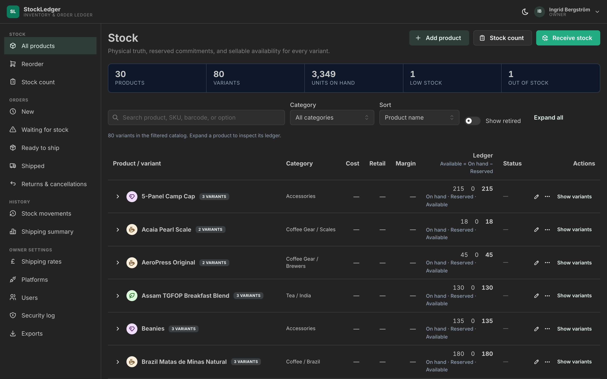
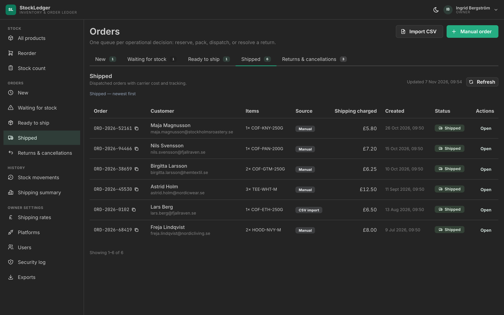

# StockLedger 📦

> A rock-solid, focused inventory and order ledger for small e-commerce merchants. Eliminates overselling, maintains exact physical stock truth, and streamlines packing and carrier dispatch without enterprise ERP bloat.

[](https://spring.io/projects/spring-boot)
[](https://openjdk.org/)
[](https://react.dev/)
[](https://www.typescriptlang.org/)
[](https://www.postgresql.org/)
[](https://www.docker.com/)
[](https://github.com/shvmpk/stock-ledger/actions/workflows/ci.yml)

> 📚 **Live documentation site:** this repository's docs are published at [shvmpk.github.io/stock-ledger](https://shvmpk.github.io/stock-ledger/) and rebuilt automatically on every change to `docs/`.

| **Stock — available = on hand − reserved** | **Orders — lifecycle queues, carrier cost, CSV import** |
| :---: | :---: |
|  |  |

---

## 📖 Governance & Architectural Documentation

StockLedger's architecture and execution are governed by these synchronized documents:

- **[PROJECT-OVERVIEW.md](docs/pages/PROJECT-OVERVIEW.md)**: Product scope, user stories, roles (`OWNER` vs `STAFF`), and strict non-negotiable boundaries.
- **[ARCHITECTURE.md](docs/pages/ARCHITECTURE.md)**: The architecture in plain English — the ledger rule, order flow, and webhook security — with the full database schema, purge runbooks, and component map kept as reference at the bottom.
- **[API.md](docs/pages/API.md)**: The complete REST endpoint reference: every route, its access rule, and its error codes.
- **[AGENTS.md](AGENTS.md)**: Operating rules, the 3-law Test-Driven Development (TDD) mandate, zero-oversell invariants, and quality gates.
- **[GUIDE.md](docs/pages/GUIDE.md)**: The merchant-facing user guide — every screen and daily workflow explained, with screenshots.
- **[DOCKER-GUIDE.md](docs/pages/DOCKER-GUIDE.md)**: Operational manual explaining the **Inner Loop** (host dev) and **Outer Loop** (multi-container production packaging).

---

## ⚡ The Core Invariant: The Ledger Equation

Available stock can **never drop below zero**, even under concurrent traffic spikes:

$$\text{Available Stock} = \text{Physical On-Hand Stock} - \text{Reserved Stock} \ge 0$$

All stock mutations utilize atomic native SQL predicates and record immutable audit trail entries in `stock_movements`.

---

## 🚀 Quickstart: Running the Application

StockLedger supports two execution workflows:

> **Platform credentials key:** Both workflows require a Base64-encoded 32-byte `PLATFORM_CREDENTIALS_KEY` for AES-256-GCM platform credential encryption. Create the gitignored project-root `.env` file once:
>
> ```bash
> [ -f .env ] || printf 'PLATFORM_CREDENTIALS_KEY=%s\n' "$(openssl rand -base64 32)" > .env
> chmod 600 .env
> ```
>
> The `dev` profile imports `.env` automatically, and Docker Compose reads it automatically. Reuse the same file across restarts; never commit it.

### 1. The Inner Loop (Fastest Local Development)
*Use for coding with instant Vite Hot-Module-Reloading and IDE debugging.*

```bash
# Terminal 1: Start PostgreSQL (port 5432)
docker compose up -d

# Terminal 2: Start Spring Boot backend with pre-seeded demo dataset (port 8080)
# Reads PLATFORM_CREDENTIALS_KEY from the project-root .env file
./gradlew bootRun --args='--spring.profiles.active=dev'

# Terminal 3: Start Vite frontend development server (port 5173)
cd frontend && bun run dev
```

Open **`http://localhost:5173`** in your browser.

---

### 2. The Outer Loop (Full Containerized Stack)
*Use for running the entire isolated production stack with zero host dependencies.*

```bash
# Build and boot PostgreSQL + Distroless Backend + Unprivileged Nginx Frontend
# Docker Compose reads PLATFORM_CREDENTIALS_KEY from the project-root .env file
docker compose --profile full up -d --build
```

Open **`http://localhost:3000`** in your browser.

To stop the full stack:
```bash
docker compose --profile full down
```

---

## 🔍 Secret Scanning (gitleaks)

Commits are guarded against accidental credential leaks with [gitleaks](https://github.com/gitleaks/gitleaks):

- **Pre-commit hook**: scans every staged file before a commit lands (`gitleaks git --pre-commit --staged`).
- **CI gate**: the [`gitleaks`](.github/workflows/gitleaks.yml) workflow re-scans all reachable history on every push/PR to `main`.

Enable the local hook once after cloning:

```bash
git config core.hooksPath githooks
```

Known fabricated test-fixture tokens (the high-fidelity platform adapter fixtures) are allowlisted in [`.gitleaks.toml`](.gitleaks.toml) with justification comments. The project-root `.env` (platform credentials key) is deliberately **not** allowlisted — it is gitignored and must never be committed; the hook will catch any `git add -f` accident.

---

## 🔐 Pre-Seeded Demo Credentials

| Role | Email | Password | Permissions Scope |
| :--- | :--- | :--- | :--- |
| **Store Owner** | `owner@stockledger.io` | `OwnerPass2026!` | Full access: Catalog, Orders, Ledger, Monthly Shipping Margins, Data Exports, Price Rates, Platform Sync, User Admin, Security Log |
| **Store Staff** | `staff@stockledger.io` | `StaffPass2026!` | Operations only: Catalog, Inbound Receiving, Shelf Audits, Order Packing & Dispatch, Returns Grading, Activity History |

The `dev` profile restores these two passwords and clears `must_change_password` on every backend startup, so resetting a demo account in the UI never breaks the **Use owner demo** / **Use staff demo** buttons.

### Passwords and admin access in short

- New passwords need **at least 12 characters** (checked against a common-password blocklist) and are never rotated. Passwords issued by an owner are **temporary**: the holder must choose their own before using the app, and the users list shows **Password change pending** until then.
- Keep **two active OWNER accounts** — the last-owner guard prevents removing the final owner.
- Owners review sign-ins and account changes in **Settings → Security log**; events are retained for 24 months.

Screen-by-screen detail lives in [GUIDE.md](docs/pages/GUIDE.md); password and access error codes in [API.md](docs/pages/API.md).

---

## 🛡️ Container Optimization Summary

- **Backend Container**: Multi-stage build pairing a stripped **`jlink` custom JRE (~45MB)** with Spring Boot **`layertools`** on **Google Distroless Debian 12 (glibc, non-root)**. Image size: **~165MB** with **0 OS CVEs**.
- **Frontend Container**: Multi-stage Bun build served by **`nginxinc/nginx-unprivileged:alpine-slim`** with SPA pushState routing and pre-compressed Gzip. Image size: **~20MB**.

Both packaged images are vulnerability-scanned in CI: the packaging job runs [Trivy](https://trivy.dev/) against the backend and frontend images on every push/PR, reporting `HIGH`/`CRITICAL` CVEs (unfixed vulnerabilities ignored). The scan currently runs in report mode — flip `exit-code` from `'0'` to `'1'` in [ci.yml](.github/workflows/ci.yml) to promote it to a hard build gate once the first findings are triaged.

For deep-dive mechanics and GitHub Actions CI cache setup, refer to **[DOCKER-GUIDE.md](DOCKER-GUIDE.md)**.

---

## 🧪 End-to-End Test (Playwright)

One browser-level journey runs against the real full stack (Postgres + distroless backend + nginx frontend): an owner signs in with the demo credentials and sees the seeded catalog — the browser → SPA → session cookie → API → database wiring that component tests cannot cover.

```bash
cd frontend && bun run e2e      # boots the stack (reuses it if already running), runs the test
bun run e2e:down                # stop the stack afterwards
```

- Playwright's webServer boots `docker compose --profile full`, waits for the backend to finish seeding (by polling a real login), then runs `frontend/e2e/`.
- CI runs the same suite in a dedicated **Playwright End-to-End (Full Stack)** job; failures upload the Playwright HTML report as an artifact.
- First run pays a one-time Chromium download and image build; subsequent runs take about two minutes.

---

## 📊 Load Testing (k6)

A two-mode k6 suite drives the real full stack through the nginx edge: **steady** (10 VUs browse + place orders, ~100 s latency/throughput profile) and **race** (50 simultaneous checkouts against a variant holding one unit — the zero-oversell invariant proven over the wire: exactly 1× `201`, 49× `409`, 0× `5xx`).

```bash
k6 run k6/load-test.js                      # steady mode
k6 run -e MODE=race k6/load-test.js         # oversell race
```

Both modes run against an isolated throwaway Compose stack (fresh DB volume, wiped after) so dev data is untouched — boot/teardown commands, recorded numbers, and a documented pre-existing finding are in **[LOAD-TESTING.md](docs/pages/LOAD-TESTING.md)**. Steady profile through the full stack: order placement **p95 ≈ 22 ms**, catalog browse **p95 ≈ 31 ms**, zero errors at ~7.6 orders/s.
