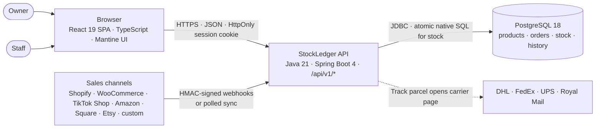

# Architecture — how StockLedger is built

This page explains the design in plain language first: the rule the whole app exists to enforce, the pieces, and how orders and stock move. The detailed reference material (full database schema, purge runbooks, credentials, screen/component map) is kept at the bottom — nothing was dropped, it just lives out of the way.

For *what the app does* see [PROJECT-OVERVIEW.md](PROJECT-OVERVIEW.md), for *how to use each screen* see [GUIDE.md](GUIDE.md), and for *every HTTP endpoint* see [API.md](API.md).

## The one rule

Everything in this section exists to keep one subtraction honest:

$$\text{Available} = \text{On hand} - \text{Reserved} \ge 0$$

- **On hand** is what is physically on the shelf.
- **Reserved** is what is promised to paid orders that have not shipped yet.
- **Available** is what a new order is allowed to take. It can never go below zero — the database itself refuses, not just the code.

Every stock change is one of three atomic SQL statements, and each one only updates when the numbers still work out. That is why two orders racing for the last unit cannot both win: the database rejects the loser. There is no in-memory "read the number, subtract, save" step anywhere.

```sql
-- Reserve stock for an order: only if `qty` is genuinely available
UPDATE inventory_levels
SET reserved_quantity = reserved_quantity + :qty,
    version = version + 1,
    updated_at = NOW()
WHERE product_variant_id = :variantId
  AND (on_hand_quantity - reserved_quantity) >= :qty;

-- Ship an order: deduct on hand and reserved, only if both counters still hold
UPDATE inventory_levels
SET on_hand_quantity = on_hand_quantity - :qty,
    reserved_quantity = reserved_quantity - :qty,
    version = version + 1,
    updated_at = NOW()
WHERE product_variant_id = :variantId
  AND on_hand_quantity >= :qty
  AND reserved_quantity >= :qty;

-- Receive stock: add to the shelf
UPDATE inventory_levels
SET on_hand_quantity = on_hand_quantity + :qty,
    version = version + 1,
    updated_at = NOW()
WHERE product_variant_id = :variantId;
```

Every one of those statements also writes one permanent line to the stock diary (`stock_movements`) — see *How stock works* below.

## The big picture



- **Frontend** — a React 19 + TypeScript single-page app (Mantine UI, built with Bun). Screens live under **Stock**, **Orders**, **History**, and owner-only **Settings**. Component map: [Reference E](#frontend-screens-component-map).
- **Backend** — one Spring Boot service exposing `/api/v1/*` REST endpoints. The server decides everything: role checks, whether stock is available, and the wording of refusals. The frontend hides things by role, but the API is the real gate. Complete endpoint list: [API.md](API.md).
- **Database** — PostgreSQL 18, migrated by Flyway (17 migrations, V1–V17). Full schema: [Reference A](#complete-database-schema).
- **Roles** — staff do the warehouse work (stock, orders, packing, shipping, returns, counting). Owners additionally see money and configuration (shipping summary, rates, platforms, users, security log, exports). A staff account never receives cost or margin figures — the server withholds them.

## How stock works

- **One row per variant.** `inventory_levels` holds the two numbers — `on_hand_quantity` and `reserved_quantity`. Creating a product writes a zero-stock row for every variant automatically, so receiving works immediately.
- **Every change writes one diary line.** `stock_movements` records receive, order reserved, order shipped, order cancelled, return restock, return damaged, and audit correction — each with the SKU and product name *as they were recorded*, the reason, a link to the order/receipt/count that caused it, and who did it. Diary rows are never edited or deleted.
- **History survives catalogue edits.** Order lines and diary rows keep the SKU and product name they were written with. Renaming a SKU or editing a product changes only the working catalogue and future entries.
- **Retirement replaces deletion.** Products and variants have independent active flags; a variant is sellable only when both are active. Retirement never rewrites its variants, and restoring a product brings back exactly the variants that were sellable before. A retired item refuses new orders and receiving with `409 PRODUCT_RETIRED`, but returns and restocks still work — the goods physically exist. Retire and restore append to an append-only history with who, what, and when; retiring something already retired appends nothing.
- **Unknown is not zero.** Cost price, weight, and reorder level may be blank. A blank cost produces no margin figure at all (an em dash, not a fake 100%), a blank weight is blank everywhere, and a blank reorder level means the variant is never low-stock. Zero remains a real, deliberate value.

## How orders work

An order is in exactly one queue: **New** (stock reserved, needs packing), **Waiting for stock**, **Ready to ship** (packed, waiting for carrier), **Shipped**, or **Returns & cancellations**.

- **Four ways in:** a manual form, a CSV import (bad rows are reported per row; good rows still save), a signed webhook from a shop, or a sync pull from Shopify/WooCommerce.
- **At intake the server tries to reserve immediately.** If the shelf is short, CSV, webhook, and sync orders go to *Waiting for stock* (filled oldest-first by the next delivery), while a manual order is refused outright with the insufficient-stock message — manual orders never park in a queue.
- **Pack** is one click: New → Ready to ship. **Ship** records carrier, parcel size, tracking number, the price-list cost (or an actual-cost override), deducts stock, and fills the order's Shipment section with a **Track parcel** link.
- **Cancel** (pending, waiting, or ready orders only) releases the reserved stock and writes the diary line. **Process return** grades each unit as SELLABLE (back into on-hand stock) or DAMAGED (written off, never sellable); the order becomes *Partially returned* or *Returned*.
- **Shipping cost** comes from the owner's 4×3 price list (DHL, FedEx, UPS, Royal Mail × Small, Medium, Large). Without an active rate, dispatch blocks until the owner sets one or an override is entered.

## Platform connections

A merchant connects their shops in two ways:

- **Managed connectors — Shopify, WooCommerce.** The app pulls orders (**Sync now**) and also accepts inbound webhooks. **Test connection** makes a real authenticated call and reports the result in plain words.
- **Webhook channels — TikTok Shop, Amazon, Square, Etsy, and custom addresses** (Zapier, Make.com, scripts). Inbound-only: the channel pushes orders to the connection's address. The app never calls them out; the card shows *Awaiting first inbound order* or the last order's arrival instead.

Each connection gets a URL-safe **slug** (`tiktok-us`) that forms its webhook address `/api/v1/webhooks/orders/tiktok-us`; the slug is the connection's identity. The list of supported channels — display names, credential fields, signature headers — lives in one place (an enum) and is served to the setup screen, so adding a channel is one enum constant.

**Inbound orders are safe by construction.** The raw request body is read once and re-read for signature checking, the connection's secret is decrypted from an AES-256-GCM blob, and the vendor header (`X-Shopify-Hmac-Sha256`, `X-Square-HMAC-SHA256`, or universal `X-StockLedger-Signature`) is compared in constant time against HMAC-SHA256 over the raw body. A mismatch is a plain 401. Replays are dropped by a 24-hour idempotency window, and accepted orders reserve stock atomically.

**Editing a connection cannot clash.** Every edit must carry the `version` the client last read; a save built on stale data is refused with `409 CONCURRENT_CHANGE` instead of overwriting newer changes. A create may carry an `Idempotency-Key` — the same key returns the original connection rather than a duplicate. Pausing requires a reason, shown on the card and kept in history. The webhook address cannot be changed after creation.

**Outbound calls are guarded.** The app only contacts a merchant's shop over HTTPS, resolves the address and checks every returned IP against private/loopback/link-local ranges *before* opening a socket, follows no redirects, caps the response size, and applies connect and read timeouts. Failures become plain-language messages containing no credentials.

## Keeping the numbers right

Three append-only trails record what happened. Each is enforced by a database trigger that rejects `UPDATE` and `DELETE`, and each is retained for 24 months; purging is a manual, recorded operation ([Reference C](#append-only-purge-runbooks)), never an application job.

- **`stock_movements`** — every stock change. The diary behind every figure.
- **`auth_events`** — every sign-in, failed sign-in, logout, password change or reset, and user-administration change, with actor and subject names/emails snapshotted (no foreign keys, so history survives account deletion). Passwords and session ids are never logged; every row carries a request id. Audit failures during sign-in are logged and counted rather than blocking sign-in, while state-changing flows fail closed if the audit write fails.
- **`platform_connection_events`** — every platform save, pause, resume, and test, as one row naming the affected **field names** only. Values, tokens, and secrets are never written; a save that changes nothing appends nothing.

For dashboards, Micrometer counters live under `stockledger.auth.*` (`login`, `login.failure`, `password.change`, `password.reset`, `audit.write_failure`). Owners review sign-ins and account changes in the security log viewer with activity/time/user filters; staff never see it.

## Deployment

One app, two ways to run it — full instructions and troubleshooting in [DOCKER-GUIDE.md](DOCKER-GUIDE.md). Both need a `PLATFORM_CREDENTIALS_KEY` ([Reference D](#platform-credentials-key)).

- **Inner loop (development):** host processes for instant feedback — Vite hot reload, Gradle incremental compile — with only PostgreSQL in Docker.
- **Outer loop (whole stack):** `docker compose --profile full up -d --build` at `http://localhost:3000`. The backend image is a distroless non-root Spring Boot runtime with a jlink-stripped JRE (~165MB); the frontend is served by an unprivileged nginx container (~20MB) that proxies `/api` and `/actuator` to the backend.

---

# Reference

The details. Not needed to use or trust the app — kept here so every claim above can be checked against specifics.

## Complete database schema

The database is migrated via **Flyway (V1 through V17)** and consists of the relational tables below:

```mermaid
erDiagram
    USERS ||--o{ REFRESH_TOKENS : has
    USERS {
        uuid id PK
        varchar email UK
        varchar password_hash
        varchar full_name
        varchar role "OWNER, STAFF"
        boolean active
        boolean must_change_password "Temporary owner-issued password"
        timestamp password_changed_at
        timestamp created_at
        timestamp updated_at
    }

    AUTH_EVENTS {
        uuid id PK
        varchar event_type "LOGIN_SUCCEEDED ... ROLE_CHANGED"
        varchar failure_reason "INVALID_PASSWORD, UNKNOWN_EMAIL, INACTIVE_ACCOUNT"
        uuid actor_user_id "Snapshot, no FK"
        varchar actor_email "Snapshot, no FK"
        uuid subject_user_id "Snapshot, no FK"
        varchar subject_email "Snapshot, no FK"
        inet ip_address
        varchar user_agent
        varchar request_id
        jsonb details
        timestamp occurred_at
    }

    PRODUCTS ||--|{ PRODUCT_VARIANTS : contains
    PRODUCTS {
        uuid id PK
        varchar name
        varchar description
        varchar category
        boolean active
        timestamp created_at
        timestamp updated_at
    }

    PRODUCT_VARIANTS ||--|| INVENTORY_LEVELS : tracks
    PRODUCT_VARIANTS ||--o{ STOCK_MOVEMENTS : logs
    PRODUCT_VARIANTS ||--o{ ORDER_ITEMS : ordered_as
    PRODUCT_VARIANTS ||--o{ STOCK_COUNT_ITEMS : audited_in
    PRODUCTS ||--o{ PRODUCT_CATALOG_EVENTS : recorded_in
    PRODUCT_VARIANTS ||--o{ PRODUCT_CATALOG_EVENTS : recorded_in
    PRODUCT_VARIANTS {
        uuid id PK
        uuid product_id FK
        varchar sku UK
        varchar barcode
        varchar option_name
        varchar option_value
        numeric cost_price "Nullable; unknown means no margin"
        numeric selling_price
        int weight_grams "Nullable; unknown means not recorded"
        int min_stock_threshold "Nullable; null means no low-stock warning"
        boolean active
        timestamp created_at
        timestamp updated_at
    }

    PRODUCT_CATALOG_EVENTS {
        uuid id PK
        uuid product_id "Snapshot, no FK"
        uuid variant_id "Snapshot, null for PRODUCT scope"
        varchar scope "PRODUCT, VARIANT"
        varchar change_type "RETIRED, RESTORED"
        varchar product_name "Snapshot at record time"
        varchar variant_sku "Snapshot at record time"
        uuid actor_user_id "Snapshot, no FK"
        varchar actor_email "Snapshot, no FK"
        timestamp occurred_at
    }

    INVENTORY_LEVELS {
        uuid id PK
        uuid product_variant_id FK,UK
        int on_hand_quantity "Physical stock"
        int reserved_quantity "Reserved committed stock"
        bigint version "Optimistic lock"
        timestamp updated_at
    }

    STOCK_MOVEMENTS {
        uuid id PK
        uuid product_variant_id FK
        varchar sku "Snapshot at record time"
        varchar product_name "Snapshot at record time"
        int delta_on_hand
        int delta_reserved
        varchar reason "RECEIVE, ORDER_RESERVED, ORDER_SHIPPED, RETURN_RESTOCK, RETURN_DAMAGED, AUDIT_CORRECTION"
        varchar reference_type "ORDER, RECEIVING, RETURN, STOCK_COUNT, MANUAL_RESTOCK"
        uuid reference_id "Order, receiving, return, or count id"
        uuid actor_id FK
        varchar notes
        timestamp created_at
    }

    ORDERS ||--|{ ORDER_ITEMS : contains
    ORDERS ||--o{ ORDER_RETURNS : returned_in
    ORDERS {
        uuid id PK
        varchar order_number UK "ORD-<year>-<suffix>; suffix from the atomic order_number_seq sequence"
        varchar customer_name
        varchar customer_email
        varchar shipping_address
        varchar status "PENDING, WAITING_FOR_STOCK, READY_TO_SHIP, SHIPPED, RETURNED, PARTIALLY_RETURNED, CANCELLED"
        varchar source "MANUAL, CSV, WEBHOOK, PLATFORM_SYNC"
        varchar carrier "DHL, FEDEX, UPS, ROYAL_MAIL"
        varchar parcel_size "SMALL, MEDIUM, LARGE"
        varchar tracking_number
        numeric customer_shipping_charge
        numeric actual_shipping_cost
        timestamp shipped_at
        timestamp created_at
        timestamp updated_at
    }

    ORDER_ITEMS {
        uuid id PK
        uuid order_id FK
        uuid product_variant_id FK
        varchar sku "Snapshot at record time"
        int quantity
        numeric unit_price
        numeric total_price
    }

    ORDER_RETURNS ||--|{ ORDER_RETURN_ITEMS : contains
    ORDER_RETURNS {
        uuid id PK
        uuid order_id FK
        uuid processed_by FK
        varchar return_reason
        varchar notes
        timestamp created_at
    }

    ORDER_RETURN_ITEMS {
        uuid id PK
        uuid order_return_id FK
        uuid product_variant_id FK
        int quantity
        varchar condition "SELLABLE, DAMAGED"
    }

    STOCK_COUNTS ||--|{ STOCK_COUNT_ITEMS : contains
    STOCK_COUNTS {
        uuid id PK
        varchar session_name
        varchar status "IN_PROGRESS, COMPLETED, CANCELLED"
        uuid initiated_by FK
        timestamp completed_at
        timestamp created_at
    }

    STOCK_COUNT_ITEMS {
        uuid id PK
        uuid stock_count_id FK
        uuid product_variant_id FK
        int expected_on_hand
        int counted_on_hand
        int variance
        boolean reconciled
    }

    SHIPPING_PRICE_LIST {
        uuid id PK
        varchar carrier UK
        varchar parcel_size UK
        numeric rate
        boolean active
        timestamp updated_at
    }

    PLATFORM_CONNECTIONS {
        uuid id PK
        varchar platform_type "SHOPIFY, WOOCOMMERCE, TIKTOK_SHOP, AMAZON, SQUARE, ETSY, CUSTOM_WEBHOOK"
        varchar display_name "Merchant-defined label e.g. US TikTok Shop"
        varchar slug UK "URL-safe identifier e.g. tiktok-us"
        varchar store_url
        varchar encrypted_credentials "AES-256-GCM webhook secret and API tokens"
        varchar sync_status "SUCCESS, RUNNING, FAILED"
        timestamp last_sync_at
        varchar last_error_message
        boolean active
        varchar pause_reason "Why it is paused; cleared on resume"
    }

    PLATFORM_CONNECTION_EVENTS {
        uuid id PK
        uuid platform_connection_id "Snapshot, no FK"
        varchar platform_type "Snapshot at the time"
        varchar change_type "CREATED, UPDATED, PAUSED, RESUMED"
        uuid actor_user_id "Snapshot, no FK"
        varchar actor_email "Snapshot, no FK"
        jsonb fields "Affected field names only, never values"
        varchar reason "Pause reason, when the change is PAUSED"
        timestamp occurred_at
    }

    IDEMPOTENCY_RECORDS {
        uuid id PK
        varchar idempotency_key UK
        varchar request_hash
        text response_body
        int response_status
        timestamp expires_at
        timestamp created_at
    }
```



`auth_events` is a standalone append-only trail with **no foreign keys** to `users`: actor and subject identifiers plus emails are snapshotted so the security history survives account deactivation or deletion. A database trigger rejects `UPDATE` and `DELETE`; `TRUNCATE` remains the documented test cleanup and break-glass purge escape hatch.

`platform_connection_events` follows the same pattern: no foreign keys, a database trigger rejecting `UPDATE` and `DELETE`, and `TRUNCATE` as the documented escape hatch. One row per save, with the connection id and platform type snapshotted and the affected **field names** stored as JSONB. Values, tokens, and signing secrets are never written. `CREATED`, `PAUSED`, and `RESUMED` are their own kinds; a save that changes several fields is one `UPDATED` row whose `fields` list names them.

**Historical product snapshots (V14).** `order_items.sku` and `stock_movements.sku`/`product_name` are written from the variant and product at the moment the row is created. Editing a product or renaming a SKU changes the working catalogue only; past order lines and stock movements keep the values they were recorded with, and their responses read the snapshot instead of the current variant. Stock movements receive the snapshot values explicitly, because the native inventory update clears the JPA persistence context before the movement is built. Product creation also writes a zero-stock `inventory_levels` row for every variant, so receiving stock works immediately.

**Retirement and catalogue history (V15).** `products.active` and `product_variants.active` are independent flags; a variant is sellable only when both it and its product are active. Retiring a product does not rewrite its variants, so restoring the product preserves the per-variant decisions made earlier. `product_catalog_events` is an append-only trail with the same trigger-and-`TRUNCATE` pattern as `auth_events`: it snapshots the product name, variant SKU, actor, and time at `PRODUCT` or `VARIANT` scope, records `RETIRED` and `RESTORED`, and appends nothing when the requested state already holds. Order intake (manual, CSV, webhook, platform sync) and supplier receiving refuse a retired item with `409 PRODUCT_RETIRED`; returns and restocks stay allowed because the goods physically exist.

**Optional product attributes (V16).** `cost_price`, `weight_grams`, and `min_stock_threshold` are nullable. An unknown cost produces no margin rather than a fabricated 100%, an unknown weight is written as a blank in exports, and an unknown reorder level means the variant is never low-stock. Zero remains a real, distinct value. The migration drops the old `NOT NULL` constraints and the `0` / `5` defaults, then converts legacy `cost_price = 0` and `weight_grams = 0` rows to `NULL` because those zeros were forced by the previous defaults. Existing `min_stock_threshold` values are kept: `5` was a real warning level. The conversion choice is deliberate and documented here rather than inferred.

**Reorder guidance settings (V17).** `reorder_settings` is a single-row table enforced by `ck_reorder_settings_singleton` (`id = 1`). `lead_time_days` is constrained to 1–365 days and seeded at 14; `updated_by` references `users(id)` with `ON DELETE SET NULL`, so the setting survives a user being deactivated or removed. The window and target cover are fixed calculator constants rather than stored settings: ninety days of shipped demand, a minimum of twenty-one days and five net units of history before an estimate is offered, and fourteen days of target cover on top of the lead time. Purpose-built indexes on `orders(shipped_at)` and `order_returns(processed_at)` support the rolling demand query. The lead time is an estimate input, not a purchase-order commitment; the API never treats it as an order.

## API endpoints

The complete endpoint matrix — every route, its access rule, and its error codes — lives in [API.md](API.md) so this page stays about design, not routes.

## Append-only purge runbooks

**`auth_events` (24-month retention).** Purging older rows is a manual, privileged operation performed under a change record — there is no automated purge job and the application role has no trigger-bypass privilege.

1. Open a change record naming the operator, the retention cutoff (`NOW() - INTERVAL '24 months'`), and the planned maintenance window. `ALTER TABLE ... DISABLE TRIGGER` takes an `ACCESS EXCLUSIVE` lock, so never run it during trading hours.
2. Capture the pre-purge evidence: `SELECT count(*) FROM auth_events;` and `SELECT min(occurred_at), max(occurred_at) FROM auth_events;`.
3. Connect as the table owner (a privileged operations role, **not** the application role) and run the purge in one transaction:
   ```sql
   BEGIN;
   ALTER TABLE auth_events DISABLE TRIGGER trg_auth_events_append_only;
   DELETE FROM auth_events WHERE occurred_at < NOW() - INTERVAL '24 months';
   ALTER TABLE auth_events ENABLE TRIGGER trg_auth_events_append_only;
   COMMIT;
   ```
4. Confirm the guard is back on: `SELECT tgenabled FROM pg_trigger WHERE tgname = 'trg_auth_events_append_only';` must return `O`. A failed transaction rolls the trigger change back automatically, so never commit the disable on its own.
5. Record the deleted row count and commit id in the change record. `TRUNCATE auth_events` is reserved for test cleanup or a full, explicitly approved reset; it bypasses the row trigger and must not be used for routine retention.

`platform_connection_events` follows the same procedure with table `platform_connection_events` and trigger `trg_platform_connection_events_append_only`.

## Platform credentials key

Platform credentials are encrypted with AES-256-GCM using a 32-byte key supplied through the `PLATFORM_CREDENTIALS_KEY` environment variable (bound to `app.platform.credentials-key`). The value must be Base64-encoded and decode to exactly 32 bytes. The application validates the key during startup and intentionally has no default, so a missing or malformed key prevents boot. For local development, the `dev` profile imports the gitignored project-root `.env` file via `spring.config.import=optional:file:./.env[.properties]`; Docker Compose also reads `.env` automatically. Production deployments inject the same environment variable from the platform secret store. Keep the key stable across restarts; rotating it requires re-encrypting existing platform credentials.

## Frontend screens (component map)

The frontend is built using **React 19 + TypeScript + Mantine UI + TanStack Query v5 + Bun**.

- **Authentication** (`/login`, `/account/password`)
  - `LoginPage`: Session sign-in with owner/staff demo shortcuts. A user flagged `mustChangePassword` is routed directly to the change screen, never through the app shell.
  - `ChangePasswordPage`: Forced or voluntary password change with a live policy checklist, `returnTo` support, and password-manager-safe input attributes. Rendered inside `RequireAuth` but outside `AppLayout`.
- **Stock & Inventory** (`/stock`)
  - `AllProductsPage`: Expandable variant hierarchy, ledger equation columns, search, and category filters. Owners also see **Add product** and per-product **Edit** controls. A **Why this number?** button on every variant opens the stock explanation, and `receiveSku`, `explainSku`, and `retired=1` address parameters open the receiving drawer, explanation drawer, or retired view directly.
  - `ProductFormPage` (`/stock/products/new`, `/stock/products/:productId/edit`, OWNER only): Add or edit a product, its category and description, and one or more variants with SKU, barcode, option name/value, retail and cost prices, weight, and reorder level. Server field errors land under the variant that caused them. Editing preserves variant ids and never rewrites past orders or movements.
  - `ReorderPage` (`/stock/reorder`): Buying worklist for sellable variants, most urgent first. Shows available stock, net units sold over the ninety-day window, estimated days of cover, a rounded suggested quantity, and why the item is listed. An owner can edit the supplier lead time; both roles can trace a suggestion to its shipped orders and returns, receive stock for that variant, or open **Why this number?**. Variants without enough shipped history say so rather than showing an estimate.
  - `StockExplanationDrawer`: Reusable read-only panel for one variant. Shows the three ledger figures, the reorder level's meaning, open reservation holders with order links and statuses, ninety-day movements grouped by reason with dates and net deltas, and the server's plain-language sentences. It is opened from product, reorder, and order screens and can be deep-linked with `explainSku`.
  - `ReceiveStockDrawer`: Supplier receiving drawer with instant backlog order allocation notice. Opening it from a stock refusal passes `receiveSku` so the variant is already chosen.
  - `StockCountPage`: Interactive shelf counting workspace with live variance tracking, confirmation modal, and deficit warning banner.
- **Order Intake & Fulfillment** (`/orders`)
  - `OrderQueuePage`: 5 queue tabs (New, Waiting for Stock, Ready to Ship, Shipped, Returns).
  - `ManualOrderModal`: Order creation with customer info, line item selectors, and live availability validation.
  - `CsvImportModal`: Drag-and-drop CSV import with structured partial-success report table.
  - `OrderDetailDrawer`: Comprehensive order view with line item status, address, and dispatch actions. Each line offers **Why this number?** for the variant behind its SKU.
  - `DispatchModal`: Carrier selection, parcel size resolution, tracking number entry, and external tracking URL generator.
  - `ReturnModal`: Item condition inspector grading each returned unit as `SELLABLE` or `DAMAGED`.
- **History & Reports** (`/history`)
  - `MovementsPage`: Full stock movement ledger with reason filters, dates, and operator notes. When a SKU filter is active, a banner summarises how many movements matched and the page's net on-hand and reserved deltas. Order and stock-count references are clickable.
  - `ShippingSummaryPage` (OWNER only): Monthly financial summary comparing shipping revenue charged vs carrier costs with margin badges.
  - `ExportsPage` (OWNER only): One-click streaming CSV exports for catalog, orders, and ledger history.
- **Settings & Administration** (`/settings` — OWNER only)
  - `ShippingRatesPage`: 4×3 carrier pricing matrix editor.
  - `PlatformsPage`: Lists all connected sales channels with slug-based webhook URL, sync status, and an on-demand **Sync Now** trigger for managed connectors. Each card has an actions menu with **Edit connection**, **Test connection**, **Pause/Resume connection**, and **View history**. Edit starts secrets blank, where blank means keep the existing value.
  - `AddPlatformPage` (`/settings/platforms/new`): Dedicated setup screen. The channel picker is the server catalogue, so unsupported channels appear disabled with the server's own reason. A successful create shows the webhook URL and signing secret once, with copy controls and a warning that the secret cannot be recovered.
  - `UsersPage`: User administration interface for creating, editing, resetting, and toggling staff accounts. Shows a **Password change pending** chip and a one-time generated temporary password.
  - `SecurityLogPage`: Human-readable, owner-only audit viewer. Defaults to sign-ins and security events, supports activity/time/user filters, relative timestamps with exact local-time tooltips, and a mobile card layout.
