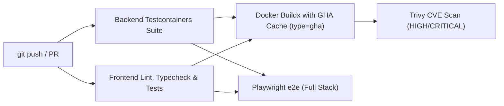

# StockLedger — Containerization & Workflow Guide

Welcome to the **StockLedger** containerization guide. This document explains the development and deployment architecture, the rationale behind our container optimization choices, and provides practical, day-to-day commands for both local development and production.

---

## 1. Two ways to run it

In enterprise software engineering, forcing developers to rebuild Docker containers after every code change kills iteration speed. We strictly separate the lifecycle into two distinct loops:

```
┌────────────────────────────────────────────────────────────────────────┐
│ 1. THE INNER LOOP (Daily Coding & Active Development)                  │
│    • PostgreSQL runs in Docker container (:5432)                      │
│    • Spring Boot runs locally on host via Gradle (:8080)               │
│    • React runs locally on host via Vite (:5173)                       │
│    • Benefits: Millisecond Hot-Reload (HMR), live IDE debuggers,      │
│      zero Docker rebuild waits.                                        │
└───────────────────────────────────┬────────────────────────────────────┘
                                    │ Commit & Push
                                    ▼
┌────────────────────────────────────────────────────────────────────────┐
│ 2. THE OUTER LOOP (Integration Verification, CI/CD & Production)       │
│    • Entire stack containerized (Postgres + Backend + Frontend)        │
│    • Immutable artifacts: stripped custom JRE on Google Distroless     │
│    • Unprivileged Nginx with pre-compressed assets & reverse proxy     │
│    • Benefits: 100% environment fidelity, zero CVEs, tiny footprint.   │
└────────────────────────────────────────────────────────────────────────┘
```

---

## 2. Daily workflow, step by step

### Before you start: the platform credentials key

The backend encrypts platform webhook secrets and API tokens with AES-256-GCM. Startup requires a Base64-encoded 32-byte key; it is read from `PLATFORM_CREDENTIALS_KEY` and there is deliberately no committed default.

Create the local `.env` file once. It is gitignored, and this command will not overwrite an existing file:

```bash
[ -f .env ] || printf 'PLATFORM_CREDENTIALS_KEY=%s\n' "$(openssl rand -base64 32)" > .env
chmod 600 .env
```

The `dev` profile imports `.env` automatically through `spring.config.import`, and Docker Compose also reads `.env` automatically. The file must use `KEY=value` syntax; do not add `export`.

Reuse the same `.env` across restarts. Existing platform credentials are encrypted with it, so changing the key makes them unreadable. Never commit `.env`.

### Workflow A: the inner loop (day-to-day development)

Use this when writing code, tweaking UI styles, fixing bugs, or stepping through code with your debugger:

#### Terminal 1 — Database
Start PostgreSQL in Docker (it persists across sessions):
```bash
docker compose up -d
```
*(Starts `stockledger-postgres` on port `5432`)*

#### Terminal 2 — Backend API
Run Spring Boot with the `dev` profile (applies Flyway migrations and populates high-fidelity seed data):
```bash
# Reads PLATFORM_CREDENTIALS_KEY from the project-root .env file
./gradlew bootRun --args='--spring.profiles.active=dev'
```
*(Listens on `http://localhost:8080`)*

#### Terminal 3 — Frontend UI
Start Vite dev server with instant Hot-Module-Reloading:
```bash
cd frontend
bun run dev
```
*(Opens on `http://localhost:5173` with proxy to `:8080`)*

---

### Workflow B: the outer loop (everything in Docker)

Use this when you want to verify that the entire system functions as a self-contained unit with **zero local host dependencies** (exactly how it will run in production or on a reviewer's computer):

```bash
# Docker Compose reads PLATFORM_CREDENTIALS_KEY from the project-root .env file
docker compose --profile full up --build
```

- Spins up:
  - **`stockledger-postgres`** (PostgreSQL 18 on internal network)
  - **`stockledger-backend`** (Custom JRE + Distroless container on port `8080`)
  - **`stockledger-frontend`** (Alpine Nginx reverse proxy on port `3000`)
- **Access the application**: Open **`http://localhost:3000`** in your browser.
- **Stop everything**:
  ```bash
  docker compose --profile full down
  ```

---

## 3. Why these containers?

### The backend image: small and shell-free

Standard Java containers are typically 400MB–800MB and bundle Linux utilities (like `sh`, `bash`, `curl`, and `apt`) that expose security vulnerabilities (CVEs). We eliminated this using a 3-stage multi-stage build:

1. **Spring Boot Exploded Layers (`layertools`)**:
   Instead of a single fat JAR, the container breaks the app into 4 distinct physical layers:
   - `BOOT-INF/lib` (Dependencies — 55MB, cached across builds)
   - `META-INF` / `org` (Spring Boot launcher classes)
   - `BOOT-INF/classes` (Your application business logic — **only ~250KB**)
   *Result*: When you push a code change, Docker only uploads a ~250KB layer instead of the entire 60MB JAR.

2. **Custom Minimal JRE via `jlink`**:
   The builder uses Java 21's `jlink` tool to extract only the JDK modules StockLedger actually requires (`java.base`, `java.sql`, `java.naming`, `java.net.http`, etc.), stripping debug headers, man pages, and compilers.
   *Result*: Drops the Java runtime from 350MB down to **~45MB**.

3. **Google Distroless Base (`gcr.io/distroless/java-base-debian12:nonroot`)**:
   Distroless images contain **zero OS packages, no package manager, and no interactive shell**. 
   - Runs as non-root user `nonroot` (UID `65532`).
   - If an attacker attempts a shell injection or command exploit, there is no shell binary to execute.
   *Result*: Final production backend container is only **~85MB with 0 critical OS CVEs**.

---

### The frontend image: nginx without root access

1. **Multi-Stage Bun Build**:
   `oven/bun:1-alpine` compiles TypeScript and minifies React assets (`bun run build`).
2. **Unprivileged Nginx Runtime (`nginxinc/nginx-unprivileged:alpine-slim`)**:
   - Runs strictly as non-root user `nginx` (UID `101`).
   - Base image is only **~12MB**.
3. **Hardened `nginx.conf`**:
   - **SPA PushState Routing**: `try_files $uri $uri/ /index.html` prevents 404s on browser reloads.
   - **Internal Reverse Proxy**: Proxies `/api/` and `/actuator/` requests to `http://backend:8080` over Docker's internal DNS network, avoiding CORS issues.
   - **Gzip & Caching**: Pre-compresses assets and applies `Cache-Control: public, max-age=31536000, immutable` to all hashed `/assets/*` bundles.

---

## 4. Automated checks (GitHub Actions)

The [ci.yml workflow](https://github.com/shvmpk/stock-ledger/blob/main/.github/workflows/ci.yml) implements a 4-stage enterprise verification matrix:



- **Buildx Layer Caching (`type=gha`)**: Docker Buildx uses GitHub Actions' cache backend. Gradle dependencies and OS layers are cached across CI runs.
- **Subsequent image builds finish in under 90 seconds**.
- **Container vulnerability scanning**: the packaged backend and frontend images are scanned with [Trivy](https://trivy.dev/), reporting `HIGH`/`CRITICAL` CVEs with unfixed vulnerabilities ignored. The scan is report-only for now (`exit-code: 0`) — switch it to `exit-code: 1` to make it a hard quality gate.
- **End-to-end (Playwright, Full Stack)**: a dedicated job boots the full containerized stack and runs one browser journey — owner login → seeded catalog — against the real backend and database.
- **Load testing (k6, local only)**: a two-mode k6 suite drives the same stack through the nginx edge — a sustained steady profile and a 50-way oversell race proving the ledger invariant over HTTP. Deliberately *not* in CI (shared-runner numbers are noise); see **[LOAD-TESTING.md](./LOAD-TESTING.md)** for the runbook and recorded numbers.

---

## 5. Quick commands

> Both backend-start workflows read `PLATFORM_CREDENTIALS_KEY` from the project-root `.env` file. Create it once with the command below; do not regenerate it on every run.

| Action | Command |
| :--- | :--- |
| **Create Local Key File (once)** | `[ -f .env ] \|\| printf 'PLATFORM_CREDENTIALS_KEY=%s\n' "$(openssl rand -base64 32)" > .env && chmod 600 .env` |
| **Start DB Only (Inner Loop)** | `docker compose up -d` |
| **Stop DB Only** | `docker compose down` |
| **Reset DB & Seed Data** | `docker compose down -v && docker compose up -d` |
| **Start Full Stack (Outer Loop)** | `docker compose --profile full up -d --build` |
| **Stop Full Stack** | `docker compose --profile full down` |
| **View Full Stack Logs** | `docker compose --profile full logs -f` |
| **Inspect Backend Container Size** | `docker images stockledger-backend` |
| **Inspect Frontend Container Size** | `docker images stockledger-frontend` |

---

## 6. Troubleshooting

### Backend exits with `app.platform.credentials-key must be set...`

**Symptom**

```text
java.lang.IllegalStateException: app.platform.credentials-key must be set to a base64-encoded 32-byte key.
```

**Cause**

The backend maps `app.platform.credentials-key` to `PLATFORM_CREDENTIALS_KEY` and intentionally has no default. The local `dev` profile imports the project-root `.env` file; if the file is missing or does not contain the key, startup fails. The key is required even when platform sync is not being used.

**Fix**

1. Create `.env` from the project root if it does not exist:

   ```bash
   [ -f .env ] || printf 'PLATFORM_CREDENTIALS_KEY=%s\n' "$(openssl rand -base64 32)" > .env
   chmod 600 .env
   ```

2. If `.env` already exists, add `PLATFORM_CREDENTIALS_KEY=<generated-key>` to it. Do not use `export`.
3. Start the backend again.

The key must decode to exactly 32 bytes. A malformed value produces `must be valid base64` or `must decode to exactly 32 bytes`. Keep the key stable across restarts; changing it makes previously encrypted platform credentials unreadable. If the key is lost, the encrypted credentials cannot be recovered: for a disposable dev database, reset it with `docker compose down -v && docker compose up -d`; otherwise re-enter the platform credentials.
