# StockLedger — simple guide

This is a plain-language walkthrough of every screen: what you see, what you can click, and what happens.

---

## The one thing to remember

> **Available = On hand − Reserved**

- **On hand** is what is physically on the shelf.
- **Reserved** is what is already promised to an order.
- **Available** is what you are allowed to sell.

Available never goes below zero. That is how the app prevents overselling.

**Staff** do the warehouse work: stock, receiving, counting, orders, packing, shipping, and returns. **Owners** can do all of that plus see shipping money, set shipping rates, manage platforms and users, review the security log, and download exports.

---

## Sign in
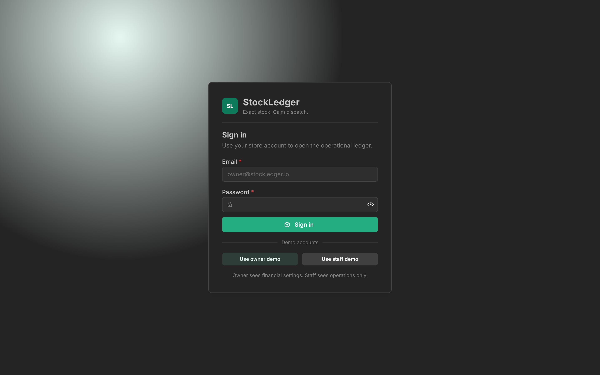

Open the app and you get the **Sign in** page.

- Type your email and password, or click **Use staff demo** / **Use owner demo** to fill them in.
- Click **Sign in**.
- A wrong login shows a red error message.

You land on **Stock → All products**. Staff see only operational menu items; owners also see **Shipping summary** and **Owner settings**.

If your password was set by an owner, it is **temporary**. After you sign in, the app goes straight to **Choose a new password** — you never see the normal menus first. The screen says *"Your store owner set a temporary password. Choose your own to continue."*

- Pick a new password of at least 12 characters. The checklist under the box ticks **At least 12 characters**, **Not a commonly used password**, **Not based on your name or email**, and **Maximum 72 characters** as you type.
- For the first 10 minutes after signing in, you are not asked for the temporary password again. After that, the **Current password** box appears with *"For your security, enter your temporary password to continue."*
- A wrong current password shows *"That password doesn't match your current one."* directly under the box — it does not sign you out.
- **Cancel** takes you back to the page you were trying to open. After **Update password**, you go there automatically.

Demo accounts:

- Staff: `staff@stockledger.io` / `StaffPass2026!`
- Owner: `owner@stockledger.io` / `OwnerPass2026!`

---

## The screen around every page

**Top bar**
- **SL logo / StockLedger** goes back to All products.
- **Burger icon** opens the sidebar on a phone.
- **Moon/sun icon** switches light/dark mode and remembers your choice.
- **Avatar, name, role** opens the user menu with your email, role, **Change password**, and **Sign out**. **Change password** opens the same password screen in normal (not forced) mode and asks for your current password.

**Sidebar**
- **Stock:** All products, Reorder, Stock count.
- **Orders:** New, Waiting for stock, Ready to ship, Shipped, Returns & cancellations.
- **History:** Stock movements. Owners also see Shipping summary.
- **Owner settings:** Shipping rates, Platforms, Users, Security log, Exports. Owners only.

If staff type an owner address directly, they get an **Owner access required** screen.

**Common parts you will see**
- Page title and a one-line description.
- A summary strip with the big numbers for pages that have one.
- Search box with a small **×** to clear it, plus filters and date pickers.
- A table of rows. Many rows can be clicked to open more detail.
- Coloured badges such as Pending, Low, Out, or Receive.
- Copy icons next to SKUs, barcodes, order numbers, and webhook paths.
- Page numbers showing "Showing 1–20 of 57".
- A friendly empty message when there is nothing to show.
- Grey placeholder rows while data loads.
- A red error box if something fails, sometimes with **Try again**.
- A green or amber toast in the top-right after an action.
- A **drawer** sliding in from the right, a **modal** in the middle, and a **confirm box** for risky actions.

**Buttons**
- **Filled green** is the main action.
- **Outline** is a secondary action like Cancel or Refresh.
- **Plain text** is a small action like Open or Edit.
- **Red** is destructive, like Cancel order or Deactivate.
- **Spinner** means wait; do not click twice.
- **Greyed out** means it is not available yet; a message nearby usually explains why.

---

## Stock → All products
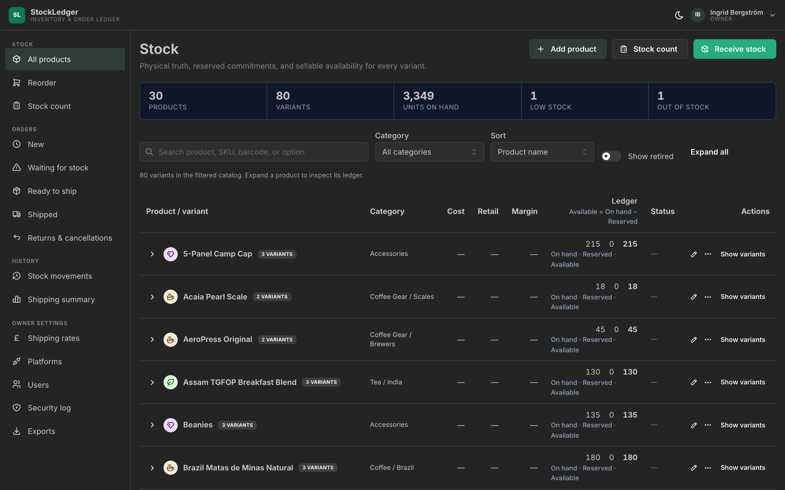

This is the home screen and the catalogue.

**What is on it**
- Summary: products, variants, units on hand, low stock, out of stock.
- Search by product, SKU, barcode, or option.
- Category filter and sort by name, SKU, or available stock low first.
- **Show retired** keeps retired products and variants out of the way until you ask for them.
- One row per product showing category, retail, total on hand/reserved/available, and a low badge. Owners also see cost and margin.
- **Show variants / Hide variants** on each product, and **Expand all / Collapse all** at the top.
- A **Why this number?** button on every variant, opening the stock explanation.

**What to click**
- **A product or Show variants** opens its variants.
- **Search**, **Category**, **Sort**, and the **×** change what is listed.
- **Add product** (owners) opens the new product form.
- **Edit** on a product (owners) opens the same form with its details filled in.
- **Receive stock** at the top right opens the receiving drawer.
- **Stock count** at the top right goes to the audit page.
- **Receive** on a variant opens the drawer with that variant chosen.
- **Count** on a variant goes to stock count with that SKU searched.
- **Why this number?** on a variant opens its stock explanation.
- **The actions menu** on a product or variant (owners) offers **Retire** and **Restore**.
- **Copy icons** copy the SKU or barcode.
- **Page numbers** move through the catalogue.

**Address links open a view directly**
- `?retired=1` turns on **Show retired**.
- `?receiveSku=HOOD-NVY-XL` opens the receiving drawer with that variant already chosen. Stock refusals use this so you can receive the missing item in one click.
- `?explainSku=HOOD-NVY-XL` opens the stock explanation for that variant.

**What happens**
- Each variant shows its own ledger: **on hand**, **reserved**, **available**, and an **In stock / Low / Out** badge.
- The caption repeats the rule: available = on hand − reserved.
- Cost and margin are owner-only. Staff see an em dash in those columns, and the server never sends those figures to a staff account.
- Only owners can add, edit, retire, or restore products. Staff still see the catalogue and every operational action.
- A retired item carries a **Retired** badge and loses its **Receive** and **Count** buttons. It cannot be ordered or received again until restored, but its past orders and stock movements stay visible.
- On a phone, the table becomes cards.

---

## Retire or restore a product
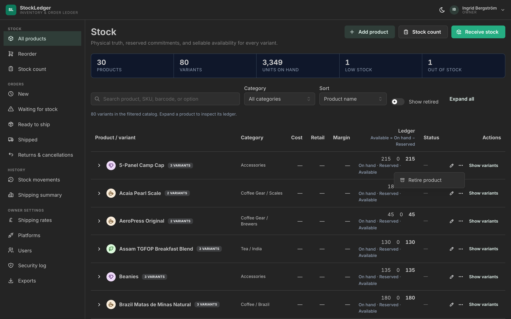

Retiring is how you stop selling something without losing its history. Nothing is deleted.

**What to click**
- Open the **actions menu** next to a product, or next to a variant inside an expanded product.
- Choose **Retire product** or **Retire variant**, then confirm.
- Tick **Show retired** to see what you have retired. Retired items stay visible while the switch is on.
- Use the same menu to choose **Restore product** or **Restore variant**.

**What happens**
- A retired product disappears from the working catalogue and from order entry. Its variants keep their own on/off setting, so restoring the product brings back exactly the variants that were sellable before.
- A retired variant disappears from the catalogue and cannot be ordered or received. Its siblings stay on sale.
- Manual orders, CSV import, webhook orders, platform sync, and supplier receiving refuse a retired item with a plain "retired" message.
- Returns and damaged-stock restocking are still allowed, because the goods physically exist.
- Every retire and restore is recorded with who did it and when. Asking to retire something that is already retired records nothing.
- The product detail page still shows every variant, retired or not, so old links and order history keep working.

---

## Add or edit a product
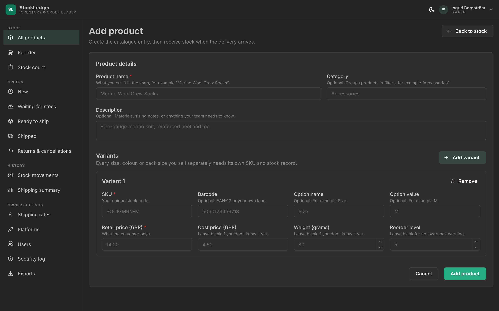

Only owners can add or edit products. Staff can still view the catalogue, receive stock, and count it.

**What is on it**
- **Product name** (required), plus optional **Category** and **Description**.
- One card per variant. **SKU** and **Retail price** are required; barcode, option name and value, cost price, weight, and reorder level are optional.
- **Add variant** adds another variant card.
- **Add product** or **Save changes** at the bottom.

**What to click**
- Type the product details.
- Give every size, colour, or pack size its own variant. A variant is the thing you actually track and sell.
- Use a SKU you will recognise, for example `SOCK-MRN-M`.
- Enter the retail price. Cost, weight, and reorder level can be left blank; what that means is explained below.
- Click **Add product** to create it, or **Save changes** to update it.

**What happens**
- A new product starts with zero stock. Use **Receive stock** when the delivery arrives.
- A blank cost, weight, or reorder level stays blank. Nothing is filled in for you.
- A duplicate SKU is refused with a message naming the SKU, and the rest of the form stays as you typed it.
- Negative prices, weights, and reorder levels are refused.
- Editing a product or SKU changes the working catalogue only. Past orders keep the SKU they were recorded with, and stock movements keep both the SKU and product name.
- Existing variants cannot be removed from this screen. That is deliberate: history must survive. Retire them from **Stock → All products** instead.

**You can leave cost, weight, and reorder level blank**

Blank means **unknown**, and the app says so rather than inventing a number.

- **Cost price blank** — owners see an em dash instead of a margin. A £0.00 cost would claim a 100% margin, which is a confident lie when you simply do not know the cost.
- **Weight blank** — the product form and the catalog export leave it blank. Use this when the weight has not been confirmed yet.
- **Reorder level blank** — that item never raises a low-stock warning. It still shows **In stock** or **Out of stock** from its actual count, so you can watch it yourself.
- **Zero is still a real value.** Entering `0` for cost means the item genuinely costs nothing; entering `0` for the reorder level means warn as soon as stock runs out. Zero and blank are different, and the app treats them differently.
- You can fill any of these in later. Nothing about receiving, selling, or counting stock depends on them.

---

## Receive stock drawer
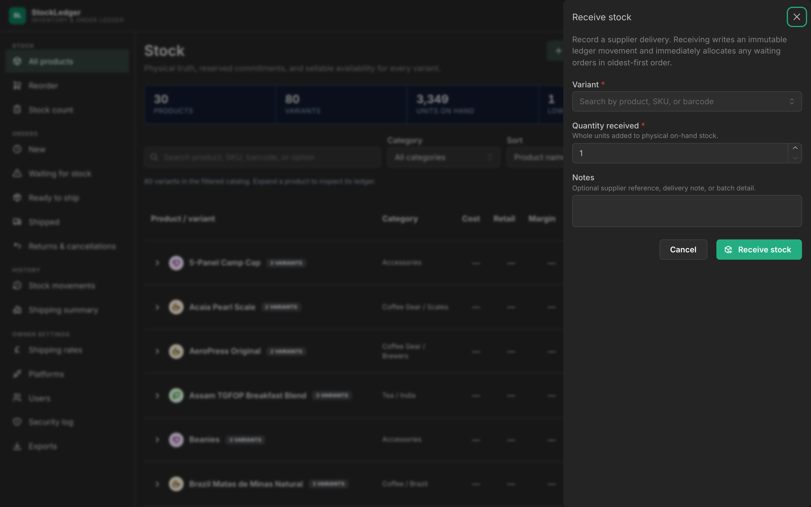

This records a supplier delivery.

**What is on it**
- A chosen variant, or a searchable **Variant** box if you opened it from the top button.
- Current on hand, reserved, and available.
- **Quantity received**, **Notes**, **Cancel**, and **Receive stock**.

**What to click**
- Pick a **Variant** if one is not already chosen. Opening the drawer from a refusal or a `receiveSku` link arrives with the variant already filled in.
- Type the quantity and optional notes.
- Click **Receive stock**.
- After success, click **Close** or **Receive more**.

**What happens**
- The quantity is added to on-hand stock.
- A permanent **Receive** line is written to the stock ledger.
- Orders waiting for that variant are filled automatically, oldest first.
- The success panel shows on hand before → after, available now, reserved after allocation, and the order numbers that got stock.
- If nothing was waiting, it says the units are available for new orders.
- An empty variant or invalid quantity shows a red error.

---

## Why this number?
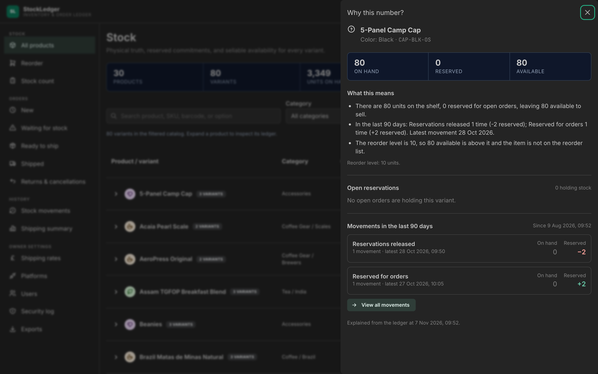

Every stock figure can explain itself, so you do not have to guess why an item cannot be sold.

**Where to find it**
- **Stock → All products:** **Why this number?** on any variant.
- **Stock → Reorder:** **Why this number?** on a row.
- **Order details:** **Why this number?** beside each line item.
- **A stock refusal:** **View reservations** opens the same explanation for the SKU in the message.
- **Directly:** `/stock/products?explainSku=HOOD-NVY-XL`.

**What it shows**
- The three figures side by side: **on hand**, **reserved**, and **available**, with the rule available = on hand − reserved.
- The plain-language sentences the server writes for that variant.
- **Open reservations:** each order holding stock, its status, how many units it holds, and when it was ordered. The order number links to the order.
- **Movements in the last 90 days:** received, reserved, shipped, returned, corrected, and so on — grouped by reason, with how many movements, the net change to on hand and reserved, and the latest date.
- The variant's **reorder level**, or a plain statement that none is set.
- A **Retired** badge when the variant can no longer be ordered or received.
- **View all movements** opens the stock ledger filtered to that SKU.

**What it means**
- Something can be on the shelf and still be unsellable: the units are reserved for open orders.
- A reservation belongs to an order, not to a person. Opening the order shows what is holding it.
- The 90-day summary is a reading aid, not a second ledger. The movements page remains the full record.
- If a figure looks wrong, compare the reservation list with the order and then check the movement history.

---

## Stock → Reorder
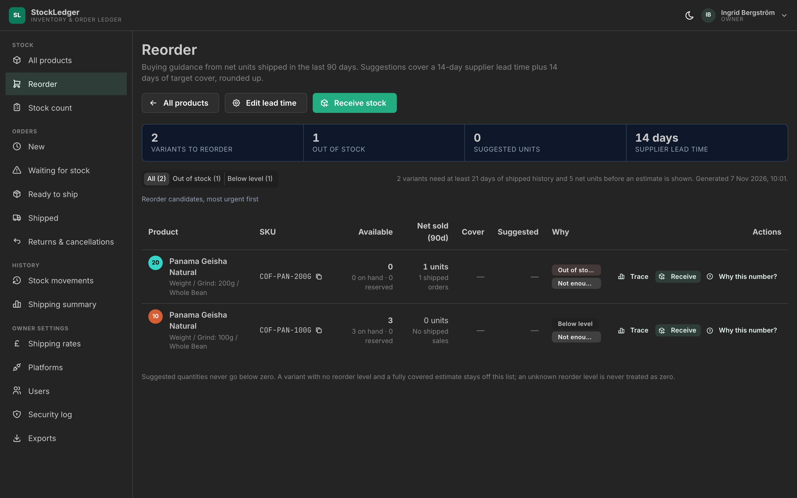

This is the buying worklist. It answers two questions: how many of each item should I order, and when will I run out?

**What it assumes**
- Demand is the net units **shipped in the last 90 days**, less processed returns. Pending, waiting, and cancelled orders do not count.
- A suggestion covers the **supplier lead time plus 14 days of target cover**, rounded up.
- An item needs at least **21 days of shipped history and 5 net units sold** before the app will estimate. Until then it says **Not enough history** instead of inventing a number.
- The default supplier lead time is **14 days**. An owner can change it; staff can read it but not edit it.
- Retired products and variants stay off the list because they cannot be sold.

**What is on it**
- A summary strip: variants to reorder, out of stock, suggested units, and the supplier lead time in use.
- Filters: **All**, **Out of stock**, **Below level**.
- Rows with product, SKU, available stock, net units sold, days of cover, suggested quantity, the reason it is listed, and actions.
- Worst items first: out of stock, then low cover, then below the reorder level.

**What to click**
- **Trace** opens a drawer showing the shipped orders and returns behind the net-sold figure, so you can check where a suggestion came from.
- **Receive** opens the receiving drawer for that variant. **Receive stock** at the top opens it without a variant chosen.
- **Why this number?** opens the stock explanation for the variant, including open reservations and recent movements.
- **Edit lead time** (owners only) changes the supplier lead time and recalculates every suggestion immediately.
- **All products** goes back to the catalogue.
- **Back to all products** appears when nothing needs reordering.

**What happens**
- **Days of cover** is available stock divided by average daily net demand. It is an estimate, not a promise.
- **Suggested quantity** is the units needed to cover the lead time plus 14 days, minus what is already available; it never goes below zero.
- **Below level** means available stock is at or under the variant's reorder level. An item with no reorder level is judged on cover and history instead.
- Receiving from here works exactly like normal receiving and can fill waiting orders immediately.
- The list refreshes after orders ship, returns are processed, stock is received, or a count is completed.

---

## Stock → Stock count
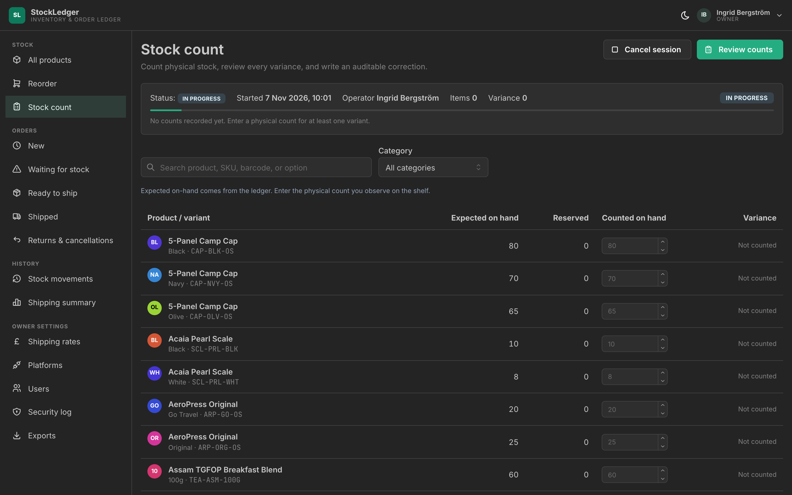

This is a physical shelf audit.

**What is on it**
- The page starts a new session or resumes one already in progress.
- A session card with status, start time, operator, item count, variance, and progress.
- Search and category filters.
- A table: expected on hand, reserved, counted on hand, and variance.
- A **Recent sessions** table at the bottom.

**What to click**
- **Counted on hand** to type what you actually counted.
- **Review counts** to see only the differences.
- **Keep counting** to go back.
- **Record & complete** to save the differences.
- **Cancel session** to abandon the session; it asks for confirmation.
- **Start new count / Start another count** to begin again.
- **View audit movements** to see the corrections in history.
- **Resume / View** to open a recent session.
- **Review reserved orders / Review reorder list** if the count is below reserved stock.

**What happens**
- Variance is counted minus expected. Negative is red, positive is amber, zero is neutral.
- Only changed variants are written.
- Completing replaces physical on-hand stock with your counts and writes an **Audit correction** movement for each difference.
- If counted stock is below reserved stock, a red warning links you to the affected orders and reorder list.
- Cancelling keeps already recorded adjustments in the ledger but discards counts you typed and did not record.
- Recent sessions show who counted, when, how many items, and the total variance.

The page resumes an open session automatically, so you may not always see a Start button.

---

## Orders
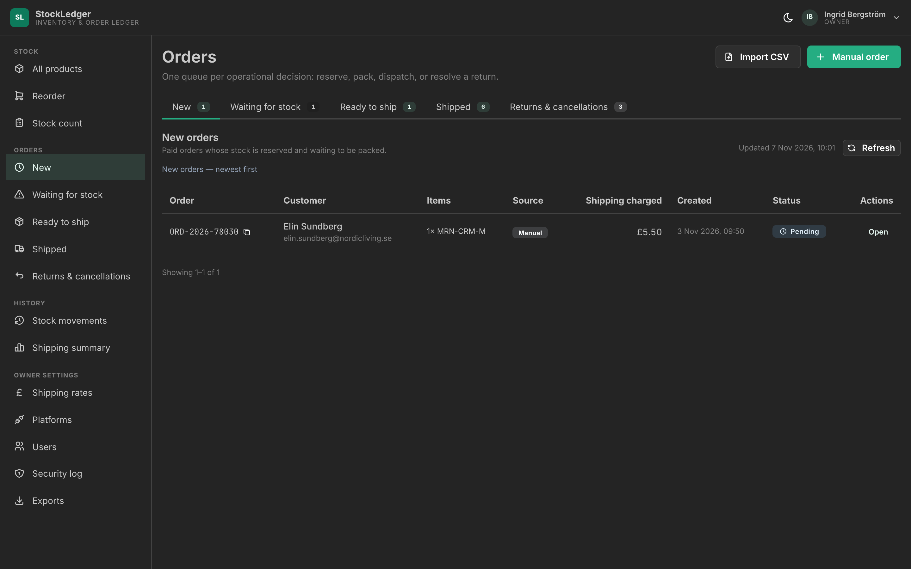

Orders move through five queues. At the top right of every queue are **Import CSV** and **Manual order**.

| Tab | What it means |
|---|---|
| **New** | Stock is reserved; the order needs packing. |
| **Waiting for stock** | There was not enough stock. It waits until a delivery fills it, oldest first. |
| **Ready to ship** | Packed and waiting for a carrier and tracking number. |
| **Shipped** | Handed to the carrier; tracking and cost are recorded. |
| **Returns & cancellations** | Returned, partially returned, and cancelled orders. |

"New" is a queue, not the create button. Use **Manual order** or **Import CSV** to create orders.

**What is on a queue page**
- The queue name, a one-line explanation, last updated time, and **Refresh**.
- A table: order number, customer, items, source, shipping charged, created date, status, and **Open**.
- Page numbers at the bottom.
- On Returns, a switch for **Returned / Partially returned / Cancelled**.

**What to click**
- **Refresh** for the latest list.
- **Open**, or anywhere on a row, to see the order.
- **Check again** on an empty queue.
- **Page numbers** to move through the list.

The **Source** column shows Manual, CSV import, Webhook, or Platform sync. An empty queue explains why instead of showing a blank table.
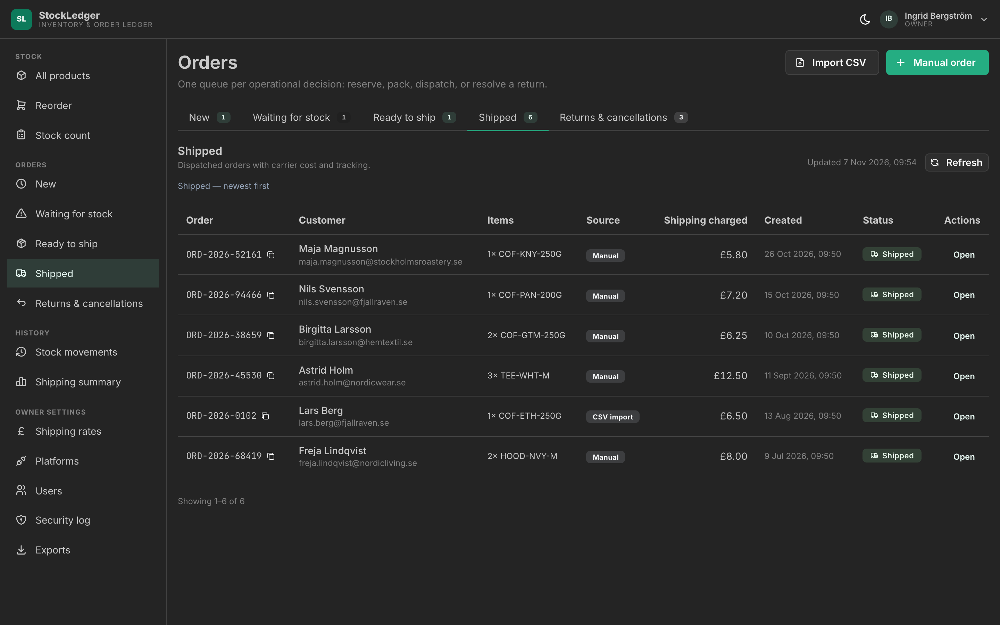

---

## Manual order
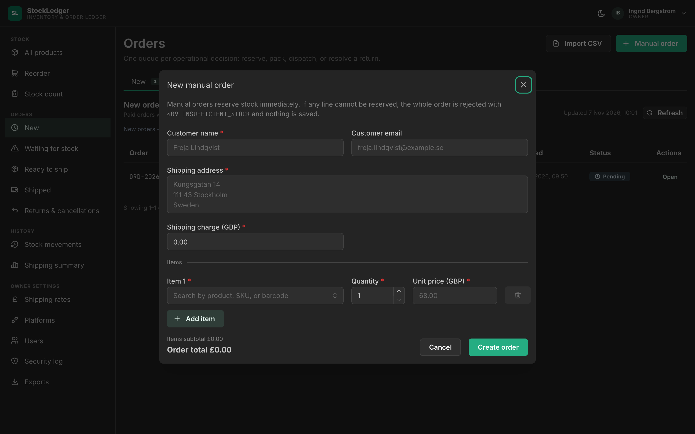

This creates one order by hand.

**What is on it**
- Customer name, email, shipping address, and shipping charge in GBP.
- One or more item rows: variant, quantity, unit price.
- Items subtotal and order total.
- **Add item**, a trash icon per row, **Cancel**, and **Create order**.

**What to click**
- Search for a **Variant**; the list shows availability.
- Set **Quantity** and **Unit price**.
- **Add item** for another line; **trash** removes one.
- **Create order** to save.
- **Cancel** to close without creating anything.

**What happens**
- The whole order is checked first. If any line lacks stock, the whole order is rejected and nothing is saved.
- A red error box explains the problem, with messages under the affected fields.
- If everything is available, stock is reserved, a **Pending** order is created, and it opens in a drawer.
- Manual orders never move to Waiting; they are rejected instead.

---

## When stock says no
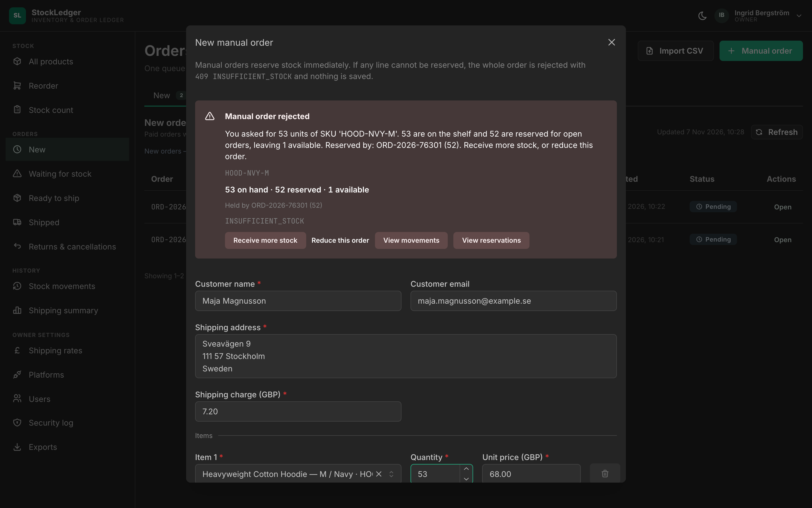

A refusal is a sentence, not a dead end. It names the SKU, the quantity you asked for, and the split between on hand, reserved, and available.

**What the message tells you**
- How many units are on the shelf and how many are reserved for open orders.
- The units genuinely available to sell.
- Which open orders are holding the reservation, when there are any.

**What you can click**
- **Receive more stock** opens the receiving drawer with that SKU already chosen.
- **View movements** opens the stock ledger filtered to that SKU.
- **View reservations** opens the stock explanation, including every order holding stock.
- **View retired products** turns on **Show retired** when the item has been retired.
- **Reduce this order** is advice, not a button. Change the quantity on the order and submit again.

**What happens**
- A refusal changes nothing. No stock is reserved, shipped, or adjusted.
- A manual order is refused as a whole when any line lacks stock.
- A shipment refused for insufficient reserved stock means the reservation was released or corrected somewhere else. Check the order's reservation or record a stock count; the message links to the movements and reservations involved.
- Receiving the missing stock can fill waiting orders immediately. Check the receiving result before retrying the order.

---

## CSV import
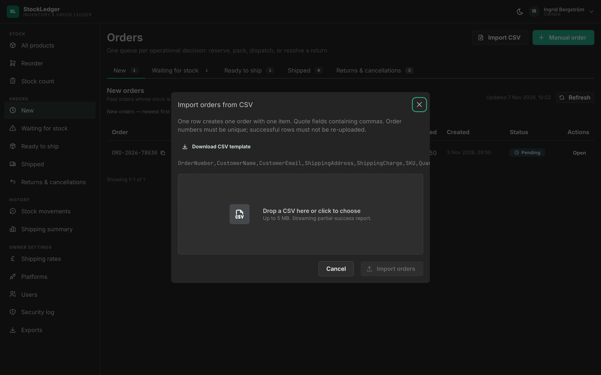

This creates many orders from a spreadsheet.

**What is on it**
- A short explanation that one row makes one order with one item.
- **Download CSV template**.
- A dropzone to drag or choose one `.csv` file up to 5 MB.
- The chosen file name, with **Remove**.
- **Cancel** and **Import orders**.
- After importing, a partial-success report.

**What to click**
- **Download CSV template** for the exact columns.
- **Dropzone** to choose the file.
- **Import orders** to start.
- **Import another file** to reset, or **Done** to go to the New queue.

**What happens**
- Good rows are saved.
- Failed rows are listed with row number, order number, SKU, and reason.
- The report shows rows read, orders imported, orders waiting for stock, and rows failed.
- Orders without stock can go to **Waiting for stock**; one bad row does not crash the file.

Do not upload the same successful file twice; order numbers must be unique.

---

## Order details
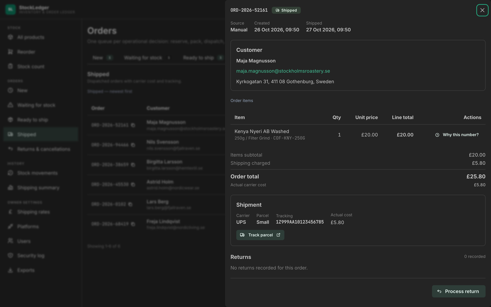

Click any order to slide in this drawer.

**What is on it**
- Order number and status.
- Source, created date, and shipped/returned dates.
- Customer name, email link, and address.
- Items with quantity, unit price, line total, and a **Why this number?** button for the variant behind the SKU.
- Items subtotal, shipping charged, order total, and actual carrier cost.
- A **Shipment** section when shipped: carrier, parcel, tracking, actual cost, **Track parcel**.
- A **Returns** section with reason, date, operator, notes, condition, and whether the item was restocked.
- Action buttons at the bottom.

**What changes with status**
- **Pending:** Cancel order, Ship, Pack order.
- **Waiting for stock:** Cancel order.
- **Ready to ship:** Cancel order, Ship.
- **Shipped:** Process return.
- **Partially returned:** Process return.
- **Returned or Cancelled:** history only, no actions.

**What to click**
- **X** or outside the drawer to close it.
- **Email** to open your mail app.
- **Track parcel** to open the carrier page.
- **Why this number?** beside an item to see its stock split, open reservations, and recent movements without leaving the order.
- **Pack order**, **Ship**, **Process return**, or **Cancel order** to take the next step.

The drawer shows the full truth for that order, including past returns and shipment details.

---

## Pack an order
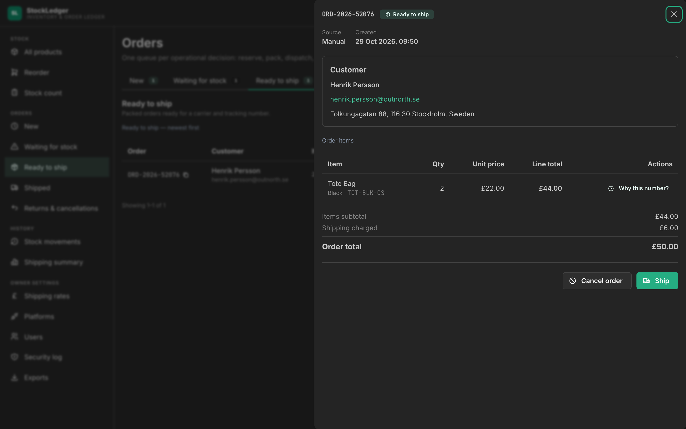

Clicking **Pack order** acts immediately.

- The order moves from **Pending** to **Ready to ship**.
- A green toast confirms it.
- Packing means the item is boxed and waiting at the bench.

Most shops pack first and ship second. Shipping straight from Pending is also possible, but packing keeps the jobs separate.

---

## Ship an order
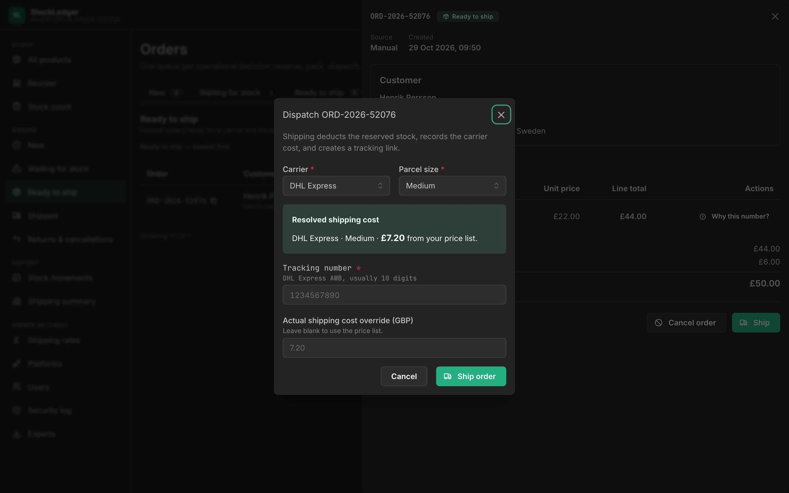

This opens the dispatch modal.

**What is on it**
- **Carrier**: DHL Express, FedEx, UPS, or Royal Mail.
- **Parcel size**: Small, Medium, or Large.
- The cost from the owner's price list, if an active rate exists.
- If no rate exists: an amber warning. Owners get a link to Shipping rates; staff are told to ask the owner.
- **Tracking number**, with a hint for the chosen carrier.
- **Actual shipping cost override**, optional.
- **Cancel** and **Ship order**.

**What to click**
- Choose **Carrier** and **Parcel size**.
- Type the **Tracking number**.
- Use the **override** only if the real cost differs from the price list.
- **Ship order** to dispatch.

**What happens**
- Stock is deducted, and an **Order shipped** movement is written.
- Carrier, parcel, tracking, and actual cost are saved.
- A tracking link is created and shown in a toast.
- The order becomes **Shipped**.
- Missing tracking, or no rate and no override, blocks the dispatch with a red error.

---

## Return an order
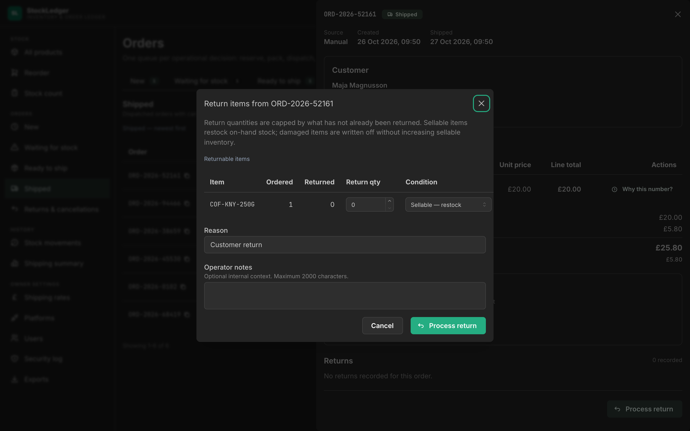

This opens the return modal.

**What is on it**
- A table of items: ordered, already returned, remaining returnable, return quantity, and condition.
- **Sellable — restock** or **Damaged — write off**.
- Fully returned lines are marked and cannot be returned again.
- **Reason** and **Operator notes**.
- **Cancel** and **Process return**.

**What to click**
- Type the **return quantity**. It cannot exceed what remains.
- Choose the **condition**.
- Add a reason and notes if useful.
- **Process return** to save.
- **Done** after success.

**What happens**
- Sellable units go back into on-hand stock and a **Return restocked** movement is written.
- Damaged units are written off and a **Return damaged** movement is written; they never become sellable.
- All units returned makes the order **Returned**; some returned makes it **Partially returned**.
- The success panel shows restocked and written-off counts.
- No quantity, or too many, shows a red error.

---

## Cancel an order

This is a confirmation box.

- It warns that reserved stock will be released, a permanent ledger line will be written, and the action cannot be undone.
- **Reason** is already filled with "Customer requested cancellation".
- **Keep order** closes safely; **Cancel order** cancels it.

**What happens**
- Reserved stock is released.
- An **Order cancelled** movement is written.
- The order moves to **Returns & cancellations → Cancelled**.
- History stays; nothing is deleted.

Cancelling is offered for pending, waiting, and ready orders, not shipped ones.

---

## History → Stock movements
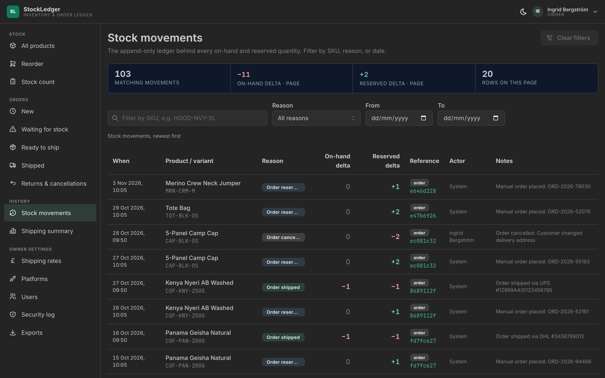

This is the permanent diary of every stock change.

**What is on it**
- Summary: matching movements, on-hand delta on the page, reserved delta on the page, rows.
- When a SKU filter is active, a banner above the table says how many movements matched and shows the page's net on-hand and reserved changes for that SKU.
- Filters: SKU, reason, From date, To date, **Clear filters**.
- Columns: when, product/variant, reason, on-hand delta, reserved delta, reference, actor, notes.
- Page numbers.

**What to click**
- Search by **SKU** or part of one.
- Pick a **Reason**: Receive, Order reserved, Order shipped, Order cancelled, Return restocked, Return damaged, or Audit correction.
- Choose **From / To** dates.
- **Clear filters** to reset.
- A **reference link** to open the order or stock count that caused the movement.

**What happens**
- Every receive, reservation, shipment, cancellation, return, and stock-count correction creates one line.
- Positive numbers are green; negative numbers are red.
- **Actor** shows who did it, or "System" for automatic actions.
- Lines are never edited or deleted.
- The SKU banner's matching count covers every page; its on-hand and reserved deltas describe the rows on the page you are looking at.
- Arriving from **View movements** or **View all movements** in an explanation pre-fills the SKU filter.

If a stock number ever looks wrong, this page explains how it got there.

---

## History → Shipping summary
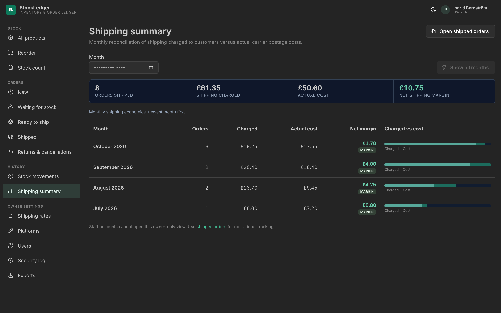

Owner-only. This is postage money, not sales revenue.

**What is on it**
- A month picker and **Show all months**.
- Orders shipped, shipping charged, actual cost, and net margin.
- A monthly table with charged, actual cost, net margin, and a charged-versus-cost bar.
- A green **Margin** or red **Loss** badge.

**What to click**
- **Month** to filter, or **Show all months** to clear.
- **Open shipped orders** to go to the Shipped queue.
- **Open ready-to-ship orders** on the empty screen.

Charged is what customers paid; actual cost is what the carrier charged you; net margin is the difference. A negative month is red and labelled **Loss**.

---

## Owner settings → Shipping rates
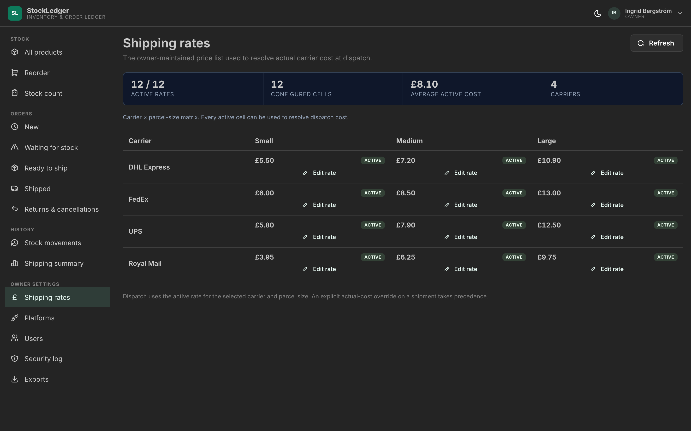

This is the price list used at dispatch.

**What is on it**
- Summary: active rates, configured cells, average active cost, carriers.
- A matrix of four carriers across three parcel sizes.
- Each cell shows a cost and **Active**, **Inactive**, or **Missing**.
- **Edit rate / Set rate** under each cell.
- A **Refresh** button.

**What to click**
- **Edit rate / Set rate** opens a modal with **Cost (GBP)** and an **Active for dispatch** switch.
- **Save rate** saves; **Cancel** closes.
- **Refresh** reloads.

**What happens**
- Active rates are used automatically when shipping that carrier and parcel size.
- Inactive rates stay listed but are never used.
- Missing rates force a cost override or an owner decision.

Staff cannot open this page.

---

## Owner settings → Platforms
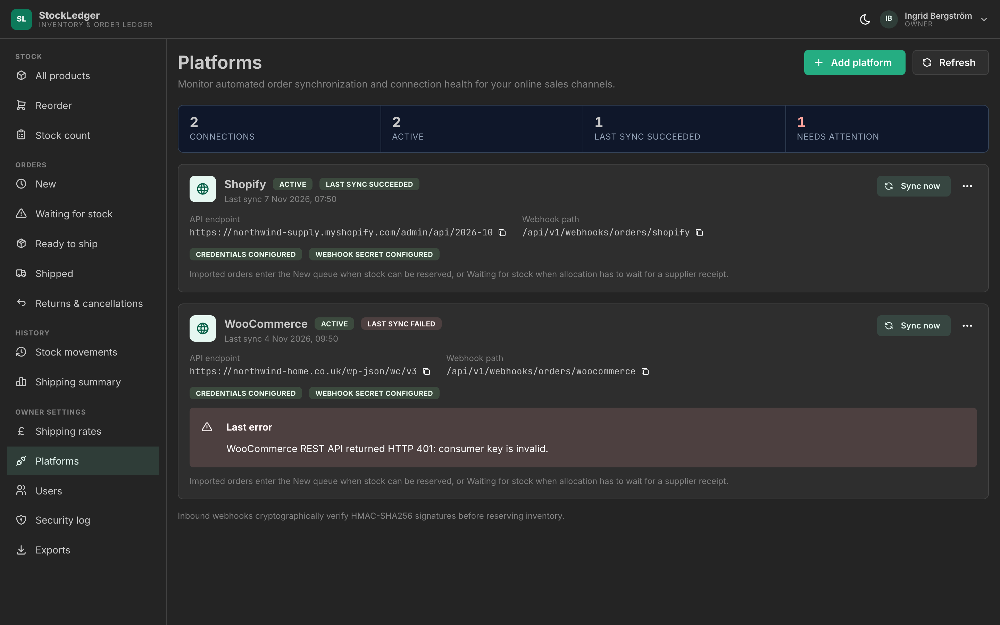

This is where you connect your online shops and check that each one still works.

**Connect a shop**
1. Click **Add platform** (or **Connect your first platform** when none exist).
2. Choose the **Sales channel**. Etsy is listed but cannot be chosen yet; the reason is shown under it.
3. Fill in:
   - **Connection name** — a name you will recognise, for example “Northwind Supply EU”.
   - **API address** — an example for the chosen channel sits under the box.
   - **API credentials** — only the fields that channel needs. A channel that only sends orders shows “No API credentials needed”.
   - **Signing secret** — at least 16 characters. Click **Generate secret** if you want one made for you.
4. Optional: open **Advanced** to set a **Custom webhook address**. Leave it blank to derive it from the connection name. Letters, numbers, and hyphens only.
5. Click **Connect platform**.
6. The next screen shows the **Webhook URL** and the **signing secret once**. Copy both into your shop now — the secret cannot be shown again after you leave this page.
7. Click **Done**.

**What is on the page**
- Summary: connections, active, last sync succeeded, needs attention.
- One card per connection with the platform name and, when it differs, your connection name, plus active/inactive, sync status, and last sync time.
- API endpoint and webhook path with copy icons.
- Credential and webhook-secret status badges.
- An “Inbound webhook only” badge when the channel cannot be read from.
- The last test result in plain words, with its message and when it was tested.
- For an inbound-only channel, “Awaiting first inbound order” or when the last order arrived.
- A grey box with the reason while a connection is paused.
- A red error box if the last sync failed.
- **Add platform** and **Refresh**.

**What to click**
- **Sync now** pulls orders. It is disabled if the connection is paused, the channel has no outbound sync, or a sync is already running.
- **Actions** (three dots) opens:
  - **Edit connection** — change the name or API address, or replace a credential or the signing secret. Leave a secret box blank to keep the current one. The webhook address is shown but cannot be changed.
  - **Test connection** — Shopify and WooCommerce make one small authenticated call. A channel that only receives orders is not called; it reports whether an order has arrived yet. A managed channel keeps its last result on the card and in history. A failed test does not stop you saving a fix.
  - **Pause connection** — stops new orders from the channel. A reason is required; it shows on the card and is kept in history. Orders already imported stay in your queues.
  - **Resume connection** — starts importing again. If another active connection already uses the same webhook address, the app refuses and names it; pause that one first.
  - **View history** — who changed what and when, including pauses and test results. Secrets and tokens are never shown. **Show older changes** loads earlier entries.
- **Copy icons** copy the endpoint or webhook path.
- **Refresh** reloads health.

**What happens**
- A successful sync shows a green toast and updates the last sync time.
- A failed sync shows a red toast and the error on the card.
- Imported orders go to **New** when stock can be reserved, or **Waiting for stock** when it cannot.

Staff cannot open this page.

---

## Owner settings → Users
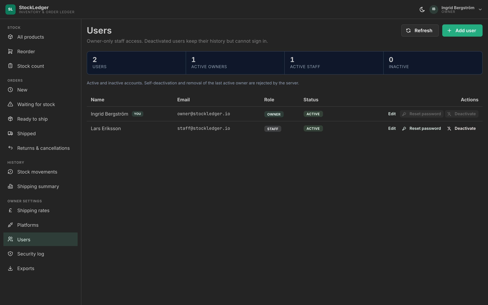

This manages who can sign in.

**What is on it**
- Summary: total users, active owners, active staff, inactive.
- A table with name, email, role, status, and actions.
- A **You** badge on your own row.
- An orange **Password change pending** chip on accounts that still have a temporary password.
- **Refresh** and **Add user**.

**What to click**
- **Add user** opens name, email, temporary password, and role. **Generate temporary password** fills the box with a 16-character value; you can also type your own (at least 12 characters).
- **Edit** opens name, role, and an active switch.
- **Reset password** opens a one-time temporary password for that person. Use the copy icon, or **Generate another** for a different value.
- **Deactivate** asks for confirmation; **Reactivate** turns the account back on.
- **Create user / Save changes / Cancel** save or close the modals.

**What happens**
- A new or reset account signs in with the temporary password, then must choose its own password before it can use the app.
- The temporary password is shown to you **once**. Copy it before you close the modal and share it securely.
- **Reset password** is greyed out on your own row with a note to use the account menu instead. Owners cannot reset their own password here.
- The role decides whether they see owner settings.
- Deactivated users keep their history but cannot sign in.
- You cannot deactivate yourself.
- The last active owner is protected, so the shop cannot lock itself out.
- Invalid fields show errors under the boxes.

Staff cannot open this page.

---

## Owner settings → Security log
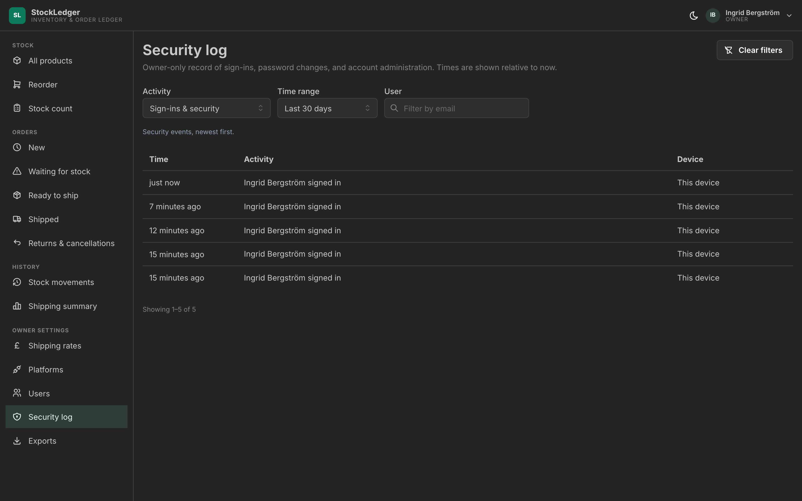

This is the owner-only record of who signed in and what changed on an account.

**What is on it**
- A table with **Time**, **Activity**, and **Device**, newest first.
- Activity is written as a sentence, for example "Mara Ellison signed in", "Failed sign-in for Theo Marsh — wrong password", or "Mara Ellison reset Theo Marsh's password".
- Times are relative ("12 minutes ago"); hover over one to see the exact local date and time.
- Your own machine shows as **This device** instead of an IP address. Other devices show the IP address with a copy icon.
- On a phone, the same events appear as stacked cards.

**What to click**
- **Activity** chooses **Sign-ins & security** (the default), **Sign-ins only**, or **All activity**. Sign-outs only appear under **All activity**.
- **Time range** chooses **Last 7 days**, **Last 30 days**, or **All time**.
- **User** filters by email address.
- **Clear filters** returns to the default view.
- Page numbers move through older events.

**What happens**
- There is no export button and no raw event data on this page. It is for reading, not downloading.
- Events are kept for 24 months. Removing older events is a manual, recorded operation — never an automatic job.
- Staff cannot open this page; they see **Owner access required**.

---

## Owner settings → Exports
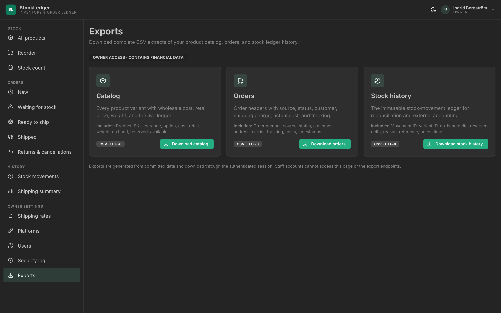

This downloads your data as CSV files.

**What is on it**
- An **Owner access · contains financial data** badge.
- Three cards: **Catalog**, **Orders**, **Stock history**, each explaining what it contains.
- A **Download** button per card.
- The name of the last downloaded file, if any.

**What to click**
- **Download catalog** for products, SKUs, barcodes, costs, prices, weights, and stock.
- **Download orders** for order headers, customers, carriers, tracking, costs, and dates.
- **Download stock history** for the full movement ledger.

CSV files download to your computer, with a green toast on success and a red error if something fails. Staff cannot open this page.

---

## Other screens

- **Owner access required** appears if staff open an owner page. It explains that the area contains financial or administrative data and offers no way around it.
- **Page not found** appears for a wrong address, with **Back to stock** and **Open orders**.
- **Dark mode** is the moon/sun icon in the top bar.
- **On a phone**, the sidebar becomes a burger menu and tables become stacked cards, with the same actions.

---

## Words you will hear

- **SKU** — the unique code for a variant, such as `HOOD-NVY-XL`.
- **Barcode** — the scan code for a variant.
- **Variant** — one sellable version of a product, such as Navy XL.
- **On hand** — physical stock on the shelf.
- **Reserved** — stock promised to orders.
- **Available** — on hand minus reserved; what you can sell.
- **Threshold** — the reorder point.
- **Shortfall** — units needed to reach the threshold.
- **Lead time** — how long a supplier usually takes to deliver after you order.
- **Days of cover** — estimated days the current available stock will last at recent net demand.
- **Suggested quantity** — units needed to cover the lead time plus 14 days, minus available stock, rounded up.
- **Movement** — one permanent line in the stock ledger.
- **Audit correction** — a movement created by completing a stock count.
- **Packing** — boxing an order at the bench.
- **Shipping / dispatch** — handing the parcel to the carrier and recording tracking and cost.
- **Restock** — putting a sellable return back into stock.
- **Write-off** — removing damaged stock without making it sellable.
- **Webhook** — an instant order notification from an online shop, verified with a secret signature.
- **Signing secret** — the shared secret your shop uses to sign each order notification. StockLedger checks it before accepting the order.
- **Test connection** — a small check that the channel's address and credential work.
- **CSV** — a spreadsheet file used to import or export data.
- **Temporary password** — a one-time password an owner creates or resets for someone. It must be changed at the next sign-in.
- **Password change pending** — the orange chip on a user row meaning that account still has a temporary password to replace.
- **Security log** — the owner-only record of sign-ins, failed sign-ins, password changes, and account changes.
